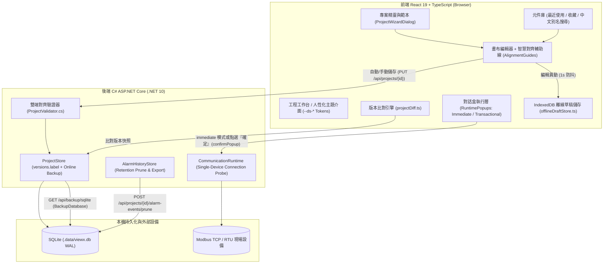

# InfoSys_ViewGP_Web 人性化升級與設計系統程式修改規格書 (AIS-47 / AIS-48)

*   **Author:** Antigravity (EGM Design Engine)
*   **Status:** Draft
*   **Date:** 2026-11-26

--------------------------------------------------------------------------------

## Overview

本設計文件依據 [AIS-47_ViewGP_人性化升級_使用者流程與互動設計.md](file:///d:/Dropbox/Infosystem/InfoSys_ViewGP_Web/Code/InfoSys_ViewGP_Web/docs/ViewGP_Web/AIS-47_ViewGP_人性化升級_使用者流程與互動設計.md) 與 [AIS-48_DESIGN_SYSTEM.md](file:///d:/Dropbox/Infosystem/InfoSys_ViewGP_Web/Code/InfoSys_ViewGP_Web/docs/ViewGP_Web/AIS-48_DESIGN_SYSTEM.md) 制定 `InfoSys_ViewGP_Web`（Web 工控 HMI 畫面規劃與監控系統）之完整程式修改規格書。

本系統採用 TypeScript + React 19 前端（含 LVGL v9 WebAssembly 22 種工控元件渲染核心）、C# ASP.NET Core (.NET 10) 後端與 SQLite 儲存。本次升級在不破壞任何既有程式行為、工控安全防護與 Playwright 自動化測試的前提下，導入六大使用者流程（F0 專案精靈、F1 直接操作對齊輔助線與快捷鍵、F2 元件庫收藏與中文別名搜尋、F3 可選交易式與非模態對話盒、F4 IndexedDB 離線草稿復原與版本比對／SQLite 一鍵備份、F5/F6 裝置連線測試與警報留存清理）以及 AIS-48 CSS Design Tokens (`--ds-*`)。

## The Problem

目前 `InfoSys_ViewGP_Web` 已具備完整的 22 種工控元件、母片繼承、Popup 對話盒、全域警報與 Modbus TCP/RTU 通訊能力，但在廠務／設備工程師、系統整合商 (SI) 與現場操作員的實際使用流程中仍存在以下問題：

1. **未儲存草稿缺乏瀏覽器端離線保護 (FR-4.1, FR-4.2)**：新專案尚未首次儲存（`revision === 0`）或後端網路短暫中斷時，若瀏覽器意外關閉或重整，記憶體中的畫面修改會直接遺失，缺少本機 IndexedDB 草稿自動備份與開啟時的主動復原機制。
2. **對話盒 (Popup) 缺乏可選的「確定／取消」批次交易模式與非模態選項 (FR-3.1, FR-3.2)**：目前所有 Popup 內的按鈕與數值輸入皆為立即寫入變數，且開啟時強制鎖定背景畫面（`inert`）。雖然即時寫入對 JOG 點動控制是必要的，但在多參數配方設定情境下，操作員需要「全部填完點確定才批次寫入、點取消則全部捨棄」的交易式對話盒，以及可同時操作背景畫面的非模態懸浮視窗。
3. **畫布排版、撤銷選取保留與元件檢索效率不足 (FR-1.1~1.5, FR-2.1~2.3)**：拖曳元件時缺乏動態邊緣／中心對齊輔助線 (`Smart Alignment Guides`)；執行復原／重做 (`undo`/`redo`) 時會無條件清空目前已選取的元件；元件庫缺少「最近使用／常用收藏」快捷區與工控常見中文俗稱（如「錶頭」、「燈號」、「微調」）搜尋支援。
4. **新手首次建置與 SI 現場調試缺乏引導工具 (FR-4.3, FR-4.4, FR-5.1, FR-6.1, FR-7.1)**：缺少含內建工控範本與通訊設定的「專案精靈」；缺少單一 Modbus 設備的即時連線測試按鈕；版本紀錄缺少版本差異比對 (`diff`)、重要版本標註與一鍵下載 SQLite 資料庫備份檔；警報歷史缺乏過期資料清理策略。
5. **樣式表缺乏集中式 CSS Design Tokens (AIS-48)**：[src/styles.css](file:///d:/Dropbox/Infosystem/InfoSys_ViewGP_Web/Code/InfoSys_ViewGP_Web/src/styles.css) 仍大量使用硬編碼色碼，尚未定義 `AIS-48` 規範之 `:root` `--ds-*` 變數，且缺少在預設工程師緊湊主題 (`.engineering-shell`) 與人性化主題之間切換的機制。

## Goals

* **G1（100% 既有程式與測試相容）**：所有與既有程式行為或自動化測試衝突的設計點，一律以目前程式既有行為為預設值（`revision === 0` 初始狀態、Popup 預設 `immediate` 即時執行與 `modal: true` 背景鎖定、JOG 點動永遠即時觸發、Modbus 斷線即停用寫入元件且不自動重送、預設啟用 `.engineering-shell` 主題），確保既有 `npm test`、`npm run test:server` 與所有 Playwright 瀏覽器測試 100% 通過。
* **G2（工控領域純淨化）**：全面剔除 `AIS-47` 內誤植之金融／台股／券商下單／保證獲利免責聲明文字，所有狀態揭露專注於工控設備連線新鮮度、未儲存變更與警報同步狀態。
* **G3（安全儲存與 IndexedDB 離線草稿復原）**：實作 `offlineDraftStore.ts`，在編輯異動時自動將草稿寫入 IndexedDB；重新開啟專案或頁面時若偵測到未同步草稿，提供「復原草稿／檢視差異／捨棄」提示；支援自訂自動儲存間隔 (`autoSaveIntervalMs`)、版本差異比對 (`projectDiff.ts`)、版本標註 (`label`) 與一鍵下載 SQLite 備份 (`GET /api/backup/sqlite`)。
* **G4（可選交易式與非模態 Popup 對話盒）**：於 `Screen` 新增可選屬性 `popupCommitMode?: "immediate" | "transactional"` 與 `popupModal?: boolean`，並新增 `confirmPopup` 動作；當啟用 `transactional` 時，對話盒內之設值／增減暫存於 `popupDrafts`，點擊「確定」才批次寫入變數，點擊「取消」或關閉則捨棄暫存。
* **G5（畫布直接操作、元件庫增強與專案精靈）**：實作拖曳對齊輔助線 (`AlignmentGuides`)、撤銷／重做保留選取狀態、擴充鍵盤快捷鍵 (`Ctrl+G`、`Ctrl+Shift+G`、`Ctrl+L`、`Ctrl+D`)、元件庫最近使用／收藏與中文別名搜尋，以及 3 步驟「專案精靈」與 4 種工控範本。
* **G6（設備連線測試、警報清理與全域狀態列可見性）**：新增後端 `POST /api/communication/test` 單機連線測試與 `POST /api/projects/{id}/alarm-events/prune` 警報歷史清理 API；於全域狀態列持續顯示資料更新時間戳、自動儲存狀態燈、裝置連線狀態與待送警報／草稿筆數。
* **G7（AIS-48 CSS Design Tokens 整合）**：於 [src/styles.css](file:///d:/Dropbox/Infosystem/InfoSys_ViewGP_Web/Code/InfoSys_ViewGP_Web/src/styles.css) `:root` 完整定義 `--ds-*` 設計 Token 並重構硬編碼屬性，同時保留 [src/engineering.css](file:///d:/Dropbox/Infosystem/InfoSys_ViewGP_Web/Code/InfoSys_ViewGP_Web/src/engineering.css) `.engineering-shell` 為預設主題並支援選單切換。

## Non-Goals

* **NG1（不將 Modbus PLC 控制寫入排入離線延遲重送佇列）**：當設備斷線時，絕不將操作員的馬達啟動、開關切換或數值寫入排入背景佇列於重連後自動補送，以避免現場設備無預警動作之工安風險。
* **NG2（不強迫既有 Popup 改為延遲交易模式）**：未明確設定 `popupCommitMode: "transactional"` 之所有既有對話盒與範本維持即時寫入行為；`action === "momentary"` (JOG 點動按鈕) 在任何模式下均不進入暫存。
* **NG3（不植入任何金融／證券免責聲明）**：不實作任何與工業 HMI 無關之投資風險或免責聲明橫幅。
* **NG4（不實作跨裝置多人協同編輯與原生行動 App）**：依 `AIS-47` Won't v1 範圍排除。

## Open Questions

* 目前無未決問題。前階段 Brainstorm 提出的 5 項架構衝突皆已確認採用「以目前程式既有行為為主、新功能採向下相容擴充、直接剔除金融免責文字」之決策。

## Critical User Journeys (CUJs)

### CUJ 1: 專案精靈與範本快速建置 (對應 AIS-47 F0)

*   **Given**: 廠務工程師開啟 ViewGP 編輯器，點擊「檔案 → 新增專案精靈…」。
*   **When**: 於步驟 1 輸入專案名稱「一號廠泵浦監控」、勾選「啟用自動儲存（預設開啟）」；於步驟 2 選取「泵浦與馬達監控範本」；於步驟 3 選取「離線模擬」並點擊「建立專案」。
*   **Then**: 系統立即載入含預設變數、儀表、指示燈、JOG 點動按鈕與參數設定 Popup 的完整畫面，顯示 3 步快速導覽提示，且頂欄與狀態列清楚顯示專案名稱、儲存狀態與資料時間戳。

### CUJ 2: 畫布智慧對齊、快捷鍵與元件庫別名檢索 (對應 AIS-47 F1 & F2)

*   **Given**: 工程師位於畫面編輯器，左側開啟元件庫面板。
*   **When**: 在搜尋框輸入中文俗稱「錶頭」或從「最近使用／收藏」點擊元件放置於畫布，並拖曳該元件靠近另一元件邊緣或中心線（距離 ≤ 4px），接著按下 `Ctrl+D` 複製或 `Ctrl+Z` 復原。
*   **Then**: 搜尋框正確篩選出 `儀表 (gauge)`；拖曳時畫布即時顯示青色／靛青色對齊輔助線並吸附定位；按下 `Ctrl+Z` 復原位置後，該元件仍維持選取狀態（不遺失選取焦點）。

### CUJ 3: 交易式對話盒 (Transactional Popup) 確定與取消 (對應 AIS-47 F3)

*   **Given**: 工程師將某 Popup 畫面的「寫入模式」設為 `transactional`（確定後批次寫入），在該 Popup 內放置綁定變數 `targetTemp`（初始值 `25`）的數值輸入框與增減按鈕，並進入「預覽」或「執行專案」模式開啟該 Popup。
*   **When**: 操作員在 Popup 內將 `targetTemp` 修改為 `80`，此時觀察底部呈現「尚有 1 項未套用變更」；分支 A：點擊「取消」或右上角關閉；分支 B：重新開啟並修改為 `80` 後點擊「確定」。
*   **Then**: 修改暫存期間，主畫面與實際變數 `targetTemp` 維持原值 `25`；分支 A 關閉後變數仍為 `25` 並提示「已捨棄對話盒變更」；分支 B 點擊「確定」後變數正式更新為 `80`、關閉 Popup 並提示「設定已套用，變數已寫入」。

### CUJ 4: IndexedDB 離線草稿復原、版本差異比對與 SQLite 備份 (對應 AIS-47 F4)

*   **Given**: 工程師編輯專案新增了 2 個元件，但尚未手動儲存至後端 SQLite（或後端連線中斷），此時瀏覽器分頁被重新整理或關閉後重開。
*   **When**: 重新開啟應用程式或載入該專案時，系統偵測到 IndexedDB 存在較新的未同步離線草稿並顯示復原橫幅；工程師點擊「檢視差異」或「復原離線草稿」，隨後於「版本紀錄與還原」視窗點擊「版本比對 (Diff)」與「下載 SQLite 備份」。
*   **Then**: 離線期間編輯的 2 個元件完整還原至畫布；版本比對面板清楚列出新增／修改／刪除之畫面、元件與變數清單；點擊下載備份時由後端串流下載一致的 `.db` SQLite 資料庫備份檔。

### CUJ 5: Modbus 設備連線測試、警報歷史清理與全域狀態列監看 (對應 AIS-47 F5 & F6)

*   **Given**: SI 工程師在「通訊設備與標籤」新增一台 Modbus TCP 設備（`127.0.0.1:502`），並在「全域警報管理與歷史」設定保留 30 天／最多 5,000 筆已解除紀錄。
*   **When**: 點擊設備卡片上的「測試連線」按鈕；並於警報歷史分頁點擊「依留存策略清理過期紀錄」與「匯出 CSV」。
*   **Then**: 系統呼叫 `POST /api/communication/test` 並於 1 秒內回傳連線成功與回應延遲 (`latencyMs`) 或明確中文錯誤原因；清理動作僅刪除超限之「已解除」歷史紀錄而完整保留「發生中」警報；全域狀態列即時更新資料新鮮度時間戳與待送佇列筆數。

--------------------------------------------------------------------------------

## Technical Plan (Architecture)

### 1. 系統架構與資料流概覽

本設計在維持既有單頁 React 編輯器 (`useEditor` + `useSimulation` + `useProjectPersistence`) 與 C# Minimal API (`Program.cs` + `ProjectStore` + `AlarmHistoryStore` + `CommunicationRuntime`) 核心架構不變的前提下，以低耦合模組擴充五大能力：

---

### 2. 資料模型與雙端驗證契約 (`schemaVersion: 1` 可選擴充)

為確保既有 `.data/viewx.db` 與 JSON 專案檔無須轉換即可直接讀取，所有新增欄位皆設為**可選 (Optional)**，並同步於前端 [src/model.ts](file:///d:/Dropbox/Infosystem/InfoSys_ViewGP_Web/Code/InfoSys_ViewGP_Web/src/model.ts) 與後端 [server/ProjectValidator.cs](file:///d:/Dropbox/Infosystem/InfoSys_ViewGP_Web/Code/InfoSys_ViewGP_Web/server/ProjectValidator.cs) 進行對稱驗證：

| 實體 / 型別 | 新增欄位名稱 | 型別與合法範圍 | 預設值 (未提供時) | 用途說明 |
| :--- | :--- | :--- | :--- | :--- |
| `Action` | `"confirmPopup"` | 字串列舉值 | — | 交易式對話盒內提交暫存變更並關閉對話盒之按鈕動作 |
| `Screen` | `popupCommitMode` | `"immediate" \| "transactional"` | `"immediate"` | 控制該 Popup 畫面內之設值／增減是否先暫存於 `popupDrafts` |
| `Screen` | `popupModal` | `boolean` | `true` | 控制該 Popup 開啟時是否鎖定背景畫面 (`inert`) |
| `Project` | `autoSaveIntervalMs` | 整數 `1000..60000` | `2000` | 自動儲存防抖間隔毫秒數 (FR-4.1) |
| `Project` | `maxPopupDepth` | 整數 `1..16` | `16` | 巢狀開啟 Popup 對話盒之最大層級上限 (FR-3.4) |
| `Project` | `alarmRetention` | `{ maxDays?: 1..3650, maxRecords?: 100..100000, autoPrune?: boolean }` | `undefined` | 警報歷史自動／手動清理策略設定 (FR-6.1) |

---

### 3. 前端核心子系統設計

#### 3.1 交易式與非模態對話盒狀態機 (`useSimulation.ts` & `RuntimePopups.tsx`)
* **狀態結構**：於 `useSimulation` 新增 `popupDrafts: Record<string, Record<string, unknown>>`（第一層 key 為 `popupScreenId`，第二層 key 為 `variableId`）。
* **數值讀取合併 (`getEffectiveValues(screenId)`)**：
  * 當渲染 `screenId` 畫面時，若該畫面為開啟中之 Popup 且 `popupCommitMode === "transactional"`，元件讀取的 `values` 為 `{ ...values, ...popupDrafts[screenId] }`，使操作員在對話盒內調整數值或切換開關時能立即看到預覽變化，但底層全域 `values` 與 Modbus 設備尚未被寫入。
* **動作攔截與提交**：
  * **暫存攔截**：當 `sourceScreen.popupCommitMode === "transactional"` 時，一般寫入動作（`set`、`toggle`、`increment`、`reset`）以及輸入元件 (`input`、`slider`、`arc`、`spinbox`、`dropdown`) 的變更，均寫入 `popupDrafts[sourceScreenId][variableId]`。
  * **JOG 點動豁免**：`action === "momentary"` 直接呼叫既有 `momentaryAction()` 寫入實際變數，確保物理點動安全。
  * **確定提交 (`confirmPopup`)**：當使用者點擊對話盒底部內建「確定」按鈕或畫面內 `action === "confirmPopup"` 之按鈕時，依序對 `popupDrafts[screenId]` 內每個 `(variableId, val)` 呼叫 `writeValue(variableId, val)`，清空該對話盒暫存並關閉對話盒，發出通知 `"設定已套用，變數已寫入"`。
  * **取消捨棄 (`closePopup`)**：當使用者點擊「取消」、右上角 `X` 或按 `Escape` 時，若 `Object.keys(popupDrafts[screenId] ?? {}).length > 0`，直接刪除 `popupDrafts[screenId]` 並發出通知 `"已捨棄對話盒變更"`（若無任何暫存變更則僅靜默關閉，維持與既有測試 `tests/screens-browser.mjs` 一致）。
* **模態與非模態控制 (`popupModal`)**：
  * 於 [CanvasEditor.tsx](file:///d:/Dropbox/Infosystem/InfoSys_ViewGP_Web/Code/InfoSys_ViewGP_Web/src/components/editor/CanvasEditor.tsx#L144) 將 `inert={running && popupIds.length > 0}` 改為檢查目前開啟的 `popupIds` 中是否至少有一個 `screen.popupModal !== false`（即預設為 `true`，相容既有測試；當所有開啟中 Popup 均設為 `popupModal === false` 時，背景畫布保持可操作）。

#### 3.2 IndexedDB 離線草稿復原與版本比對 (`offlineDraftStore.ts` & `projectDiff.ts`)
* **IndexedDB 封裝 (`src/services/offlineDraftStore.ts`)**：
  * 建立資料庫 `viewx_offline_db` (v1)，Object Store `project_drafts`（KeyPath: `projectId`）。
  * 儲存結構：`{ projectId: string, project: Project, baseRevision: number, updatedAt: number }`。
  * 環境防護：若 `typeof indexedDB === "undefined"`（例如 Node.js 測試環境），自動切換至模組內 `Map<string, OfflineDraftRecord>`，確保單元測試零錯誤。
* **觸發時機 (`useProjectPersistence.ts`)**：
  * 當 `dirty === true` 且 `!running` 時，啟動 1,000ms 防抖計時器將目前 `project` 寫入 `offlineDraftStore`。
  * 當 `save()` 成功回傳新 `revision` 時，立即呼叫 `clearOfflineDraft(project.id)`。
  * 當 `openProject(id)` 從後端載入專案時，檢查 `getOfflineDraft(id)`：若存在草稿且 `JSON.stringify(draft.project) !== JSON.stringify(loadedProject)`，將草稿存入 `recoverableDraft` state，於畫面頂部／狀態列顯示復原提示按鈕（「復原離線草稿」／「捨棄草稿」）。
* **結構化版本比對 (`src/utils/projectDiff.ts`)**：
  * 輸入 `(baseProject: Project, targetProject: Project)`，輸出：
    * `screens`: `{ added: string[], removed: string[], modified: { name: string, addedElements: number, removedElements: number, changedElements: number }[] }`
    * `variables`: `{ added: string[], removed: string[], modified: string[] }`
    * `devices`: `{ added: string[], removed: string[], modified: string[] }`
  * 整合至 [VersionHistoryDialog.tsx](file:///d:/Dropbox/Infosystem/InfoSys_ViewGP_Web/Code/InfoSys_ViewGP_Web/src/components/dialogs/VersionHistoryDialog.tsx)，讓維護人員在預覽歷史版本時可一鍵展開與目前版本的差異清單。

#### 3.3 畫布智慧對齊輔助線、撤銷選取保留與元件庫增強
* **智慧對齊輔助線 (`src/utils/alignmentGuides.ts`)**：
  * 在 `useSelection.ts` 的 `move()` 拖曳過程中，計算當前拖曳元件的 `{ left, centerX, right, top, centerY, bottom }` 與同畫面其他可見元件（加上畫布中心 `screen.width / 2`、`screen.height / 2`）的距離。
  * 若水平或垂直差距 `<= 4px`，回傳對齊線座標陣列 `guides: { axis: "x" | "y", position: number, label?: string }[]`，由 `CanvasEditor.tsx` 渲染 `.alignment-guide` 視覺輔助線，並在放開滑鼠 (`endDrag`) 時清除。
* **撤銷／重做選取保留 (`useEditor.ts` & `useHistory.ts`)**：
  * 將 `useHistory.ts` 快照上限由 50 步提升至 100 步。
  * 在 `useEditor.ts` 的 `undo()` 與 `redo()` 中，不再執行 `setSelected([])`，改為過濾保留在目標歷史快照中依然存在的 `selected` ID。
* **元件庫別名搜尋、收藏與最近使用 (`widgetRegistry.ts` & `LeftPanel.tsx`)**：
  * 在 `widgetRegistry.ts` 為 22 種元件擴充 `keywords: readonly string[]`（例如 `gauge` 加入 `"錶頭 壓力錶 轉速錶 指針 dial meter"`、`indicator` 加入 `"燈號 狀態燈 訊號燈 led lamp"`、`spinbox` 加入 `"步進 微調 數位加減"` 等），並納入 `groupedWidgets(search)` 搜尋比對。
  * 在 `LeftPanel.tsx` 追蹤最近放置的元件種類 (`viewx.recentWidgets`) 與收藏元件 (`viewx.favoriteWidgets`)，於元件庫頂部呈現快捷放置晶片列，同時**完全不更動下方 `.component-grid` 內既有 `<button>` 的 DOM 層級與文字**。

#### 3.4 專案精靈與內建工控範本 (`ProjectWizardDialog.tsx` & `projectTemplates.ts`)
* 建立 4 套通過 `validateProject()` 驗證的標準工控範本：
  1. `blank`（空白標準專案）
  2. `pump`（泵浦與馬達監控範本：含運轉狀態、溫度／壓力儀表、JOG 點動測試、交易式參數設定 Popup）
  3. `alarm`（全域警報監控中心：含 16-bit 警報 Word、遮罩變數、跑馬燈與警報清單元件）
  4. `trend`（產線多曲線趨勢與產量統計看板）
* 於「檔案」選單新增「新增專案精靈…」（保留原「新增專案」按鈕供快速重置與自動化測試使用）。

---

### 4. AIS-48 設計系統與雙主題相容架構 (`src/styles.css` & `src/engineering.css`)

1. **`:root` 設計 Token 定義 (`src/styles.css`)**：
   * 完整寫入 `AIS-48` 定義之色彩 (`--ds-color-primary: #5b6be6`, `--ds-color-surface: #ffffff`, `--ds-color-background: #f5f6fa`, `--ds-color-border: #e0e4ed`, `--ds-color-text-primary: #263044`, `--ds-color-success: #54b998`, `--ds-color-warning: #b18325`, `--ds-color-error: #b63d32`, `--ds-color-focus: #6878ee`, `--ds-color-canvas-bg: #101c2e`, `--ds-color-selected: #8a9cff`)、字型 (`--ds-font-family`, `--ds-font-family-mono`)、間距 (`--ds-space-1` ~ `--ds-space-15`)、圓角 (`--ds-radius-sm` ~ `--ds-radius-full`) 與陰影 (`--ds-shadow-xs` ~ `--ds-shadow-xl`)。
2. **雙主題共存與切換**：
   * [src/App.tsx](file:///d:/Dropbox/Infosystem/InfoSys_ViewGP_Web/Code/InfoSys_ViewGP_Web/src/App.tsx) 預設維持 `engineering-shell` 啟用狀態（`theme = "engineering"`），確保現有緊湊工程介面與所有 Playwright 測試 100% 相容。
   * 於「檢視」選單提供「人性化淺色主題」切換選項，切換時移除 `.engineering-shell` 類別以直接呈現 `src/styles.css` 由 `--ds-*` Token 驅動的人性化視覺主題。

---

### 5. 後端 C# API 與 SQLite 擴充規格 (`server/`)

1. **`GET /api/backup/sqlite` ([server/Program.cs](file:///d:/Dropbox/Infosystem/InfoSys_ViewGP_Web/Code/InfoSys_ViewGP_Web/server/Program.cs) & [server/ProjectStore.cs](file:///d:/Dropbox/Infosystem/InfoSys_ViewGP_Web/Code/InfoSys_ViewGP_Web/server/ProjectStore.cs))**：
   * 透過 `SqliteConnection.BackupDatabase(destinationConnection)` 將線上 SQLite 資料庫安全備份至暫存檔案，讀取位元組後刪除暫存檔，並以 `Results.File(bytes, "application/vnd.sqlite3", "viewx-backup-YYYYMMDD.db")` 回傳。
2. **`POST /api/projects/{id}/versions/{revision:long}/label` ([server/ProjectStore.cs](file:///d:/Dropbox/Infosystem/InfoSys_ViewGP_Web/Code/InfoSys_ViewGP_Web/server/ProjectStore.cs))**：
   * 於 `Initialize()` 執行非破壞性欄位檢查：若 `versions` 表尚無 `label` 欄位，執行 `ALTER TABLE versions ADD COLUMN label TEXT;`。
   * `ListVersions(id)` 回傳新增 `label` 欄位；新端點允許更新指定 `(project_id, revision)` 的 `label` 文字（長度上限 100 字）。
3. **`POST /api/communication/test` ([server/Program.cs](file:///d:/Dropbox/Infosystem/InfoSys_ViewGP_Web/Code/InfoSys_ViewGP_Web/server/Program.cs) & [server/CommunicationRuntime.cs](file:///d:/Dropbox/Infosystem/InfoSys_ViewGP_Web/Code/InfoSys_ViewGP_Web/server/CommunicationRuntime.cs))**：
   * 接收單筆 `CommunicationDevice` JSON，使用 `Stopwatch` 測量連線與讀取 `HoldingRegister 0`（長度 1）之耗時，捕捉 Socket / SerialPort 例外並轉譯為繁體中文診斷訊息，回傳 `{ ok: bool, latencyMs: long, message: string }`。
4. **`POST /api/projects/{id}/alarm-events/prune` ([server/AlarmHistoryStore.cs](file:///d:/Dropbox/Infosystem/InfoSys_ViewGP_Web/Code/InfoSys_ViewGP_Web/server/AlarmHistoryStore.cs))**：
   * 接收 `{ maxDays?: int, maxRecords?: int }`，僅針對 `project_id = $id AND cleared_at IS NOT NULL`（已解除之歷史事件）刪除早於 `now - maxDays` 或超出最新 `maxRecords` 筆數的紀錄，回傳 `{ deletedCount: int }`。

--------------------------------------------------------------------------------

## Alternatives Considered

### Alternative A: 強制將所有既有與新建 Popup 改為「確定後才寫入」交易模式

*   **Pros**: 所有 Popup 行為單一，不需要在 `Screen` 模型上新增 `popupCommitMode` 設定欄位。
*   **Cons**:
    1. 直接破壞 Popup 內的 JOG 點動按鈕 (`action: "momentary"`)，因為點動控制需要按住立即送出 ON、放開立即送出 OFF，無法暫存至點擊確定才執行。
    2. 破壞既有專案與整合測試 ([tests/screens-browser.mjs](file:///d:/Dropbox/Infosystem/InfoSys_ViewGP_Web/Code/InfoSys_ViewGP_Web/tests/screens-browser.mjs#L259-L265)) 對 Popup 內設值／加減按鈕即時生效的期望。
*   **Reason for Rejection**: 違反「與目前程式衝突處以現有程式為主」之最高原則，且對現場點動操作造成工安隱憂。因此改採 `popupCommitMode?: "immediate" | "transactional"`（預設 `"immediate"`）並豁免 `momentary` 點動按鈕。

### Alternative B: 設備斷線時將 Modbus 控制寫入指令存入 IndexedDB 佇列並於重連後自動補送

*   **Pros**: 表面上符合 `AIS-47` F6 對一般商業 Web App「離線操作、連線後自動同步」的描述。
*   **Cons**:
    1. 在工業控制領域，當 PLC / Modbus 設備斷線時，現場設備真實狀態未知；若將操作員在斷線期間點擊的「啟動馬達」或「開啟閥門」指令排入佇列，待數分鐘網路恢復後自動送出，將導致現場機械無預警啟動的嚴重工安事故。
    2. 直接違反現有 [useSimulation.ts](file:///d:/Dropbox/Infosystem/InfoSys_ViewGP_Web/Code/InfoSys_ViewGP_Web/src/hooks/useSimulation.ts#L129-L152) 與 [server/CommunicationRuntime.cs](file:///d:/Dropbox/Infosystem/InfoSys_ViewGP_Web/Code/InfoSys_ViewGP_Web/server/CommunicationRuntime.cs#L158-L168) 「失效標籤停用操作、寫入失敗不自動重送」的既有防護與 `tests/communication-browser.mjs` 測試。
*   **Reason for Rejection**: 工控安全優先。維持「設備斷線即停用控制寫入元件且不自動重送」，並將離線待送佇列限定於無工安風險的「警報歷史紀錄同步 (`useAlarmPersistence.ts`)」與「編輯器本機離線專案草稿 (`offlineDraftStore.ts`)」。

### Alternative C: 對尚未首次儲存的新專案 (`revision === 0`) 預設立即啟動後端 SQLite 自動儲存

*   **Pros**: 使用者打開畫面無須按任何儲存鍵，2 秒後即寫入後端 SQLite。
*   **Cons**:
    1. 使用者每次開啟系統預設載入 `demoProject()` 或點選「新增專案」瀏覽時，會在 `.data/viewx.db` 產生大量未命名的垃圾專案與完整 Base64 圖片版本快照。
    2. 破壞 [tests/browser.mjs](file:///d:/Dropbox/Infosystem/InfoSys_ViewGP_Web/Code/InfoSys_ViewGP_Web/tests/browser.mjs) 與 [tests/management.mjs](file:///d:/Dropbox/Infosystem/InfoSys_ViewGP_Web/Code/InfoSys_ViewGP_Web/tests/management.mjs) 對初始狀態 `revision === 0`（「尚未儲存」）的驗證。
*   **Reason for Rejection**: 改採雙層儲存保護：未儲存或未啟用自動儲存時，由前端 IndexedDB (`offlineDraftStore.ts`) 自動保護本機草稿；而透過「專案精靈」建立專案或於專案設定勾選 `autoSave` 且已建立專案後，才自動寫入後端 SQLite。

### Alternative D: 以 AIS-48 淺色人性化主題直接移除 `src/engineering.css` (`.engineering-shell`)

*   **Pros**: 只需要維護一套 CSS 樣式表。
*   **Cons**: 現有系統在 [src/App.tsx](file:///d:/Dropbox/Infosystem/InfoSys_ViewGP_Web/Code/InfoSys_ViewGP_Web/src/App.tsx#L18) 預設使用 `.engineering-shell` 緊湊工程工作台介面，若直接移除將改變所有面板尺寸與視覺結構，且 `AIS-48` 部分微字設定（`8px`、`9px`）不適合工廠螢幕閱讀。
*   **Reason for Rejection**: 採用雙主題共存架構，於 `src/styles.css` 實作完整 `:root` `--ds-*` Design Tokens（並確保最小可讀字級），預設維持 `.engineering-shell` 工程工作台主題，並於「檢視」選單提供主題切換。

--------------------------------------------------------------------------------

## Non-Functional Requirements

*   **Security & Industrial Safety**:
    *   Modbus 設備離線、通訊品質非 `"good"` 或標籤為唯讀 (`access: "read"`) 時，所有寫入型元件（`button` 寫入動作、`switch`、`input`、`slider`、`arc`、`spinbox`、`dropdown`）必須維持 `disabled` 狀態。
    *   SQLite 備份下載端點 (`GET /api/backup/sqlite`) 僅允許備份本系統管理的資料庫連線，不接受任何外部路徑參數以防止 Path Traversal。
*   **Performance & Storage Footprint**:
    *   IndexedDB 離線草稿寫入採 `1,000ms` 防抖，不阻塞畫布 60fps 拖曳與 LVGL WASM 渲染。
    *   警報歷史查詢維持 50 筆分頁，後端 SQLite 索引查詢回應時間 `< 1,000ms`；歷史清理 (`prune`) 僅針對 `cleared_at IS NOT NULL` 執行批次刪除。
*   **Rollout & Backward Compatibility**:
    *   所有新增 JSON 欄位皆為 `schemaVersion: 1` 的可選屬性，舊版 `.data/viewx.db` 專案與 `docs/manual/examples/泵浦監控教學.json` 無須遷移即可直接開啟與驗證通過。

--------------------------------------------------------------------------------

### Additional Resources

*   [AIS-47_ViewGP_人性化升級_使用者流程與互動設計.md](file:///d:/Dropbox/Infosystem/InfoSys_ViewGP_Web/Code/InfoSys_ViewGP_Web/docs/ViewGP_Web/AIS-47_ViewGP_人性化升級_使用者流程與互動設計.md)
*   [AIS-48_DESIGN_SYSTEM.md](file:///d:/Dropbox/Infosystem/InfoSys_ViewGP_Web/Code/InfoSys_ViewGP_Web/docs/ViewGP_Web/AIS-48_DESIGN_SYSTEM.md)
*   [AIS-49_ViewGP_程式修改規格書.md](file:///d:/Dropbox/Infosystem/InfoSys_ViewGP_Web/Code/InfoSys_ViewGP_Web/docs/ViewGP_Web/AIS-49_ViewGP_程式修改規格書.md)
*   [SQLite 資料儲存規格](file:///d:/Dropbox/Infosystem/InfoSys_ViewGP_Web/Code/InfoSys_ViewGP_Web/docs/SQLite-資料儲存規格.md)
*   [Modbus 設備通訊規格](file:///d:/Dropbox/Infosystem/InfoSys_ViewGP_Web/Code/InfoSys_ViewGP_Web/docs/Modbus-設備通訊規格.md)

### Future Improvements

*   **多語系字典抽離 (i18n)**：未來可將介面固定繁體中文字串抽離至語系檔 (`zh-TW` / `en-US`)，配合 `AIS-48` FR-8.3 提供執行期語系切換。
*   **背景伺服器端自動排程清理警報**：目前由專案設定與手動／啟動時觸發 `prune`，未來可於 C# `BackgroundService` 定期依專案 `alarmRetention` 自動執行清理。

--------------------------------------------------------------------------------

## Detailed Implementation Plan

### Target Files to Create/Modify

#### 1. [`src/model.ts`](file:///d:/Dropbox/Infosystem/InfoSys_ViewGP_Web/Code/InfoSys_ViewGP_Web/src/model.ts) (Modify)

*   **Type / Scope**: TypeScript Data Model & Schema-v1 Validator
*   **Rationale**: 新增交易式對話盒、非模態對話盒、自動儲存間隔、巢狀上限與警報留存策略之可選型別欄位與驗證邏輯，以支援 AIS-47 F3/F4/F5 流程且不破壞既有 schema-v1 專案。
*   **Proposed Changes**:
    *   於 `Action` 型別與 `validateProject` 動作清單新增 `"confirmPopup"`。
    *   於 `Screen` 型別新增 `popupCommitMode?: "immediate" | "transactional"` 與 `popupModal?: boolean`，並在 `validateProject` 驗證其合法值。
    *   新增 `AlarmRetentionPolicy` 型別（`maxDays?: number`, `maxRecords?: number`, `autoPrune?: boolean`），並於 `Project` 型別新增 `alarmRetention?: AlarmRetentionPolicy`、`autoSaveIntervalMs?: number` (`1000..60000`)、`maxPopupDepth?: number` (`1..16`) 及對應之 `validateProject` 數值範圍檢查。

#### 2. [`server/ProjectValidator.cs`](file:///d:/Dropbox/Infosystem/InfoSys_ViewGP_Web/Code/InfoSys_ViewGP_Web/server/ProjectValidator.cs) (Modify)

*   **Type / Scope**: C# Backend JSON Schema Validator
*   **Rationale**: 與前端 `src/model.ts` 保持 100% 雙端契約同步，確保新欄位可通過後端 `PUT /api/projects/{id}` 驗證並寫入 SQLite。
*   **Proposed Changes**:
    *   於 `Actions` HashSet 新增 `"confirmPopup"`。
    *   於 `IsValid(JsonElement project)` 新增對 `autoSaveIntervalMs` (`1000..60000` 整數)、`maxPopupDepth` (`1..16` 整數)、`alarmRetention`（`maxDays: 1..3650`, `maxRecords: 100..100000`, `autoPrune: bool`）、`screen.popupCommitMode` (`"immediate" | "transactional"`) 與 `screen.popupModal` (`bool`) 的可選屬性驗證。

#### 3. [`src/services/offlineDraftStore.ts`](file:///d:/Dropbox/Infosystem/InfoSys_ViewGP_Web/Code/InfoSys_ViewGP_Web/src/services/offlineDraftStore.ts) (Create)

*   **Type / Scope**: TypeScript Browser IndexedDB Persistence Service
*   **Rationale**: 實作 AIS-47 FR-4.2 離線草稿儲存與復原，在後端未儲存或網路中斷時保護工程師未儲存的編輯內容。
*   **Proposed Changes**:
    *   定義 `OfflineDraftRecord = { projectId: string; project: Project; baseRevision: number; updatedAt: number }`。
    *   實作 `saveOfflineDraft(record: OfflineDraftRecord): Promise<void>`、`getOfflineDraft(projectId: string): Promise<OfflineDraftRecord | null>`、`getLatestOfflineDraft(): Promise<OfflineDraftRecord | null>` 與 `clearOfflineDraft(projectId: string): Promise<void>`。
    *   當 `typeof indexedDB === "undefined"` 時自動降級至記憶體 `Map`，確保 Node.js 測試環境正常運作。

#### 4. [`src/utils/projectDiff.ts`](file:///d:/Dropbox/Infosystem/InfoSys_ViewGP_Web/Code/InfoSys_ViewGP_Web/src/utils/projectDiff.ts) (Create)

*   **Type / Scope**: TypeScript Pure Utility Module
*   **Rationale**: 實作 AIS-47 FR-4.3 版本紀錄比對 (`diff`) 與離線草稿差異預覽。
*   **Proposed Changes**:
    *   實作 `diffProjects(base: Project, target: Project): ProjectDiffSummary`，比對兩份專案快照的畫面增刪改、各畫面內元件增刪與屬性變更數量、變數增刪改以及通訊設備設定變更，回傳結構化差異摘要與總變更計數 `totalChanges`。

#### 5. [`src/utils/alignmentGuides.ts`](file:///d:/Dropbox/Infosystem/InfoSys_ViewGP_Web/Code/InfoSys_ViewGP_Web/src/utils/alignmentGuides.ts) (Create)

*   **Type / Scope**: TypeScript Geometry Utility Module
*   **Rationale**: 實作 AIS-47 FR-1.2 拖曳時顯示對齊輔助線與吸附預視。
*   **Proposed Changes**:
    *   定義 `AlignmentGuide = { axis: "x" | "y"; position: number; start: number; end: number }`。
    *   實作 `computeAlignmentGuides(movingElements: Element[], otherElements: Element[], screenWidth: number, screenHeight: number, thresholdPx = 4): { guides: AlignmentGuide[]; snapDeltaX: number; snapDeltaY: number }`。

#### 6. [`src/services/projectTemplates.ts`](file:///d:/Dropbox/Infosystem/InfoSys_ViewGP_Web/Code/InfoSys_ViewGP_Web/src/services/projectTemplates.ts) (Create)

*   **Type / Scope**: TypeScript Built-in HMI Project Templates Service
*   **Rationale**: 實作 AIS-47 FR-5.1 / FR-5.2 專案精靈所需之內建常見工控畫面範本。
*   **Proposed Changes**:
    *   定義 `ProjectTemplateId = "blank" | "pump" | "alarm" | "trend"`。
    *   實作 `createProjectFromTemplate(options: { name: string; description: string; templateId: ProjectTemplateId; width: number; height: number; autoSave: boolean; transport: "offline" | "tcp" | "rtu"; tcpHost?: string; tcpPort?: number; rtuPort?: string; rtuBaud?: number }): Project`。

#### 7. [`src/components/dialogs/ProjectWizardDialog.tsx`](file:///d:/Dropbox/Infosystem/InfoSys_ViewGP_Web/Code/InfoSys_ViewGP_Web/src/components/dialogs/ProjectWizardDialog.tsx) (Create)

*   **Type / Scope**: React Dialog Component
*   **Rationale**: 實作 AIS-47 F0 3 步驟專案精靈與 3 張快速上手導覽提示卡。
*   **Proposed Changes**:
    *   提供步驟 1（專案命名、解析度、預設勾選啟用自動儲存）、步驟 2（4 種工控範本視覺卡片選擇）、步驟 3（離線模擬 / Modbus TCP / COM RTU 設定與即時連線測試按鈕）與完成後的 3 步滑動導覽提示。

#### 8. [`src/hooks/useProjectPersistence.ts`](file:///d:/Dropbox/Infosystem/InfoSys_ViewGP_Web/Code/InfoSys_ViewGP_Web/src/hooks/useProjectPersistence.ts) (Modify)

*   **Type / Scope**: React Custom Hook
*   **Rationale**: 串接 `offlineDraftStore.ts` 與可調式自動儲存間隔 `autoSaveIntervalMs` (FR-4.1, FR-4.2)。
*   **Proposed Changes**:
    *   將固定 `2000` 毫秒計時器改為讀取 `project.autoSaveIntervalMs ?? 2000`。
    *   新增 `recoverableDraft` 狀態與 `recoverOfflineDraft()` / `discardOfflineDraft()` 動作；當 `dirty` 為真時防抖寫入 IndexedDB，當 `save()` 成功時清除對應 IndexedDB 草稿。

#### 9. [`src/hooks/useSimulation.ts`](file:///d:/Dropbox/Infosystem/InfoSys_ViewGP_Web/Code/InfoSys_ViewGP_Web/src/hooks/useSimulation.ts) (Modify)

*   **Type / Scope**: React Runtime Simulation & Device Control Hook
*   **Rationale**: 實作 AIS-47 F3 可選交易式對話盒 (`popupCommitMode === "transactional"`)、非模態操作判斷 (`popupModal`) 與自訂巢狀層級上限 (`maxPopupDepth`)，同時保護既有即時動作與 JOG 點動安全。
*   **Proposed Changes**:
    *   新增 `popupDrafts` 狀態、`confirmPopup(targetScreenId?: string)` 與 `getScreenValues(targetScreenId: string)`。
    *   在 `action()` 與 `input()` 中檢查來源畫面是否為 `popupCommitMode === "transactional"`：若是（且 `action !== "momentary"`），將目標變數新值寫入 `popupDrafts[sourceScreenId][variableId]`；若 `action === "confirmPopup"` 則執行 `confirmPopup(sourceScreenId)`。
    *   在 `canOperate()` 中支援當最上層 Popup 設為 `popupModal === false` 時允許操作下層畫面或背景畫面。
    *   新增 `lastDataTimestamp` 狀態供全域狀態列顯示資料新鮮度時間戳。

#### 10. [`src/services/screenRules.ts`](file:///d:/Dropbox/Infosystem/InfoSys_ViewGP_Web/Code/InfoSys_ViewGP_Web/src/services/screenRules.ts) & [`src/services/dataRules.ts`](file:///d:/Dropbox/Infosystem/InfoSys_ViewGP_Web/Code/InfoSys_ViewGP_Web/src/services/dataRules.ts) (Modify)

*   **Type / Scope**: TypeScript Domain Rules Services
*   **Rationale**: 支援 `project.maxPopupDepth ?? 16` 巢狀上限檢查以及按鈕 `action === "confirmPopup"` 免綁定變數規則。
*   **Proposed Changes**:
    *   `screenRules.ts` 之 `openPopup()` 改為讀取 `project.maxPopupDepth ?? 16`。
    *   `dataRules.ts` 之 `bindingTypes()`、`bindingProblems()`、`actionPatch()`、`evaluateAction()` 將 `"confirmPopup"` 納入導覽／對話盒控制動作（不要求綁定變數，回傳 `{ confirmPopup: true }`）。

#### 11. [`src/components/editor/RuntimePopups.tsx`](file:///d:/Dropbox/Infosystem/InfoSys_ViewGP_Web/Code/InfoSys_ViewGP_Web/src/components/editor/RuntimePopups.tsx) & [`src/components/editor/ScreenStructureFields.tsx`](file:///d:/Dropbox/Infosystem/InfoSys_ViewGP_Web/Code/InfoSys_ViewGP_Web/src/components/editor/ScreenStructureFields.tsx) (Modify)

*   **Type / Scope**: React Editor & Runtime Popup Components
*   **Rationale**: 提供交易式對話盒底部「確定／取消」操作列、模態／非模態標示徽章，以及畫面屬性設定欄位 (FR-3.1, FR-3.2)。
*   **Proposed Changes**:
    *   於 `ScreenStructureFields.tsx` 當畫面為對話盒 (`isPopup(screen)`) 時，渲染「對話盒寫入模式（即時寫入／確定後批次寫入）」與「背景互動（模態鎖定背景／非模態允許操作背景）」選單。
    *   於 `RuntimePopups.tsx` 根據 `screen.popupModal !== false` 切換遮罩層 pointer-events 與標題列狀態徽章；當 `screen.popupCommitMode === "transactional"` 時渲染底部交易確認列（「未套用變更數」、「取消」、「確定」按鈕）。

#### 12. [`src/hooks/useSelection.ts`](file:///d:/Dropbox/Infosystem/InfoSys_ViewGP_Web/Code/InfoSys_ViewGP_Web/src/hooks/useSelection.ts), [`src/hooks/useHistory.ts`](file:///d:/Dropbox/Infosystem/InfoSys_ViewGP_Web/Code/InfoSys_ViewGP_Web/src/hooks/useHistory.ts), [`src/hooks/useEditor.ts`](file:///d:/Dropbox/Infosystem/InfoSys_ViewGP_Web/Code/InfoSys_ViewGP_Web/src/hooks/useEditor.ts) & [`src/hooks/useEditorShortcuts.ts`](file:///d:/Dropbox/Infosystem/InfoSys_ViewGP_Web/Code/InfoSys_ViewGP_Web/src/hooks/useEditorShortcuts.ts) (Modify)

*   **Type / Scope**: React Editor Interaction Hooks
*   **Rationale**: 實作 AIS-47 F1 智慧對齊輔助線、100 步跨畫面撤銷且保留選取狀態、擴充快捷鍵與主題切換狀態。
*   **Proposed Changes**:
    *   `useSelection.ts`：於拖曳與縮放時呼叫 `computeAlignmentGuides()`，回傳 `alignmentGuides` 並在 `endDrag` 時清空。
    *   `useHistory.ts`：將歷史紀錄保留步數由 50 步提升至 100 步。
    *   `useEditor.ts`：`undo()` / `redo()` 保留在還原後畫面仍存在的 `selected` 元件 ID；新增 `duplicate()`（快速複製選取元件）與 `theme`（`"engineering" | "humanized"`，預設 `"engineering"`）狀態。
    *   `useEditorShortcuts.ts`：新增 `Ctrl+G`（群組）、`Ctrl+Shift+G`（取消群組）、`Ctrl+L`（切換鎖定）、`Ctrl+D`（快速複製）。

#### 13. [`src/registry/widgetRegistry.ts`](file:///d:/Dropbox/Infosystem/InfoSys_ViewGP_Web/Code/InfoSys_ViewGP_Web/src/registry/widgetRegistry.ts) & [`src/components/editor/LeftPanel.tsx`](file:///d:/Dropbox/Infosystem/InfoSys_ViewGP_Web/Code/InfoSys_ViewGP_Web/src/components/editor/LeftPanel.tsx) (Modify)

*   **Type / Scope**: Component Registry & Left Library Panel
*   **Rationale**: 實作 AIS-47 F2 元件庫中文別名搜尋、最近使用與常用收藏快捷放置，且維持 `.component-grid` 原有按鈕選擇器 100% 相容。
*   **Proposed Changes**:
    *   `widgetRegistry.ts`：為 22 種元件定義中文俗稱與功能關鍵字索引 `widgetKeywords: Record<Kind, string>` 並整合入 `groupedWidgets(search)`。
    *   `LeftPanel.tsx`：於元件搜尋框下方新增可收合之「最近使用 / 常用收藏」快捷放置區（點擊元件時自動更新 `localStorage` 最近使用清單），下方 `.component-grid` 維持既有 DOM 結構與按鈕名稱不變。

#### 14. [`src/components/editor/CanvasEditor.tsx`](file:///d:/Dropbox/Infosystem/InfoSys_ViewGP_Web/Code/InfoSys_ViewGP_Web/src/components/editor/CanvasEditor.tsx), [`src/components/editor/AppHeader.tsx`](file:///d:/Dropbox/Infosystem/InfoSys_ViewGP_Web/Code/InfoSys_ViewGP_Web/src/components/editor/AppHeader.tsx), [`src/registry/editorMenus.ts`](file:///d:/Dropbox/Infosystem/InfoSys_ViewGP_Web/Code/InfoSys_ViewGP_Web/src/registry/editorMenus.ts) & [`src/types/editor.ts`](file:///d:/Dropbox/Infosystem/InfoSys_ViewGP_Web/Code/InfoSys_ViewGP_Web/src/types/editor.ts) (Modify)

*   **Type / Scope**: Main Workspace UI, Menus & Status Bar
*   **Rationale**: 渲染畫布對齊輔助線、離線草稿復原提示列、專案精靈選單入口、主題切換選單與全域狀態列新鮮度時間戳／待送筆數 (AIS-47 M1/M4/M6)。
*   **Proposed Changes**:
    *   `types/editor.ts`：`Dialog` 型別新增 `"wizard"`；`VersionRow` 型別新增 `label?: string`。
    *   `editorMenus.ts`：「檔案」選單新增「新增專案精靈…」與「下載 SQLite 資料庫備份」；「檢視」選單新增「人性化淺色主題」切換項。
    *   `CanvasEditor.tsx`：於畫布渲染 `alignmentGuides` 線段；當 `recoverableDraft` 存在時顯示離線草稿復原橫幅；於底部 `.status-bar` 顯示資料新鮮度時間戳與待送佇列筆數。

#### 15. [`src/components/dialogs/ProjectDialogs.tsx`](file:///d:/Dropbox/Infosystem/InfoSys_ViewGP_Web/Code/InfoSys_ViewGP_Web/src/components/dialogs/ProjectDialogs.tsx), [`src/components/dialogs/VersionHistoryDialog.tsx`](file:///d:/Dropbox/Infosystem/InfoSys_ViewGP_Web/Code/InfoSys_ViewGP_Web/src/components/dialogs/VersionHistoryDialog.tsx), [`src/components/dialogs/CommunicationDialog.tsx`](file:///d:/Dropbox/Infosystem/InfoSys_ViewGP_Web/Code/InfoSys_ViewGP_Web/src/components/dialogs/CommunicationDialog.tsx), [`src/components/dialogs/AlarmManagementDialog.tsx`](file:///d:/Dropbox/Infosystem/InfoSys_ViewGP_Web/Code/InfoSys_ViewGP_Web/src/components/dialogs/AlarmManagementDialog.tsx) & [`src/components/editor/ElementDataFields.tsx`](file:///d:/Dropbox/Infosystem/InfoSys_ViewGP_Web/Code/InfoSys_ViewGP_Web/src/components/editor/ElementDataFields.tsx) (Modify)

*   **Type / Scope**: React Configuration Dialogs & Property Inspector
*   **Rationale**: 串接專案設定新欄位、版本比對／標註／SQLite 備份、Modbus 單機連線測試、警報歷史清理／匯出，以及按鈕 `"confirmPopup"` 動作選項。
*   **Proposed Changes**:
    *   `ProjectDialogs.tsx`：掛載 `dialog === "wizard"` 渲染 `<ProjectWizardDialog />`；於專案設定視窗新增「自動儲存間隔 (ms)」與「對話盒最大巢狀層級 (1~16)」設定。
    *   `VersionHistoryDialog.tsx`：整合 `diffProjects()` 顯示版本差異摘要、支援編輯版本標註 (`label`) 與一鍵下載 SQLite 備份。
    *   `CommunicationDialog.tsx`：於設備列表每台設備旁新增「測試連線」按鈕，顯示連線延遲或錯誤訊息。
    *   `AlarmManagementDialog.tsx`：新增警報留存清理設定（保留天數／最大筆數／立即清理按鈕）與匯出警報歷史 CSV 按鈕。
    *   `ElementDataFields.tsx`：按鈕互動動作下拉選單新增 `<option value="confirmPopup">確認並套用對話盒 (Confirm)</option>`。

#### 16. [`src/services/projectApi.ts`](file:///d:/Dropbox/Infosystem/InfoSys_ViewGP_Web/Code/InfoSys_ViewGP_Web/src/services/projectApi.ts) & [`src/services/communicationApi.ts`](file:///d:/Dropbox/Infosystem/InfoSys_ViewGP_Web/Code/InfoSys_ViewGP_Web/src/services/communicationApi.ts) (Modify)

*   **Type / Scope**: Frontend HTTP Client Services
*   **Rationale**: 封裝對後端新增 4 個 API 端點的 HTTP 呼叫。
*   **Proposed Changes**:
    *   `projectApi.ts`：新增 `updateVersionLabel(id: string, revision: number, label: string)`、`downloadSqliteBackup()` 與 `pruneAlarmHistory(id: string, policy: { maxDays?: number; maxRecords?: number })`。
    *   `communicationApi.ts`：新增 `testDeviceConnection(device: CommunicationDevice): Promise<{ ok: boolean; latencyMs: number; message: string }>`。

#### 17. [`src/styles.css`](file:///d:/Dropbox/Infosystem/InfoSys_ViewGP_Web/Code/InfoSys_ViewGP_Web/src/styles.css) & [`src/App.tsx`](file:///d:/Dropbox/Infosystem/InfoSys_ViewGP_Web/Code/InfoSys_ViewGP_Web/src/App.tsx) (Modify)

*   **Type / Scope**: CSS Design System Tokens & Root Theme Host
*   **Rationale**: 落實 `AIS-48_DESIGN_SYSTEM.md` 之 `:root` `--ds-*` CSS Custom Properties，並新增對齊輔助線、專案精靈、版本比對與交易式對話盒底部工具列樣式。
*   **Proposed Changes**:
    *   `src/styles.css`：於 `:root` 定義完整 `--ds-color-*`、`--ds-font-*`、`--ds-text-*`、`--ds-space-*`、`--ds-radius-*`、`--ds-shadow-*`、`--ds-z-*` 變數並套用至基礎元件，新增 `.alignment-guide`、`.wizard-steps`、`.version-diff-box`、`.transactional-popup-footer`、`.draft-recovery-banner` 樣式。
    *   `src/App.tsx`：依 `editor.theme` 動態組合 `"app-shell" + (editor.theme === "engineering" ? " engineering-shell" : "")`（預設為 `"engineering"`）。

#### 18. [`server/Program.cs`](file:///d:/Dropbox/Infosystem/InfoSys_ViewGP_Web/Code/InfoSys_ViewGP_Web/server/Program.cs), [`server/ProjectStore.cs`](file:///d:/Dropbox/Infosystem/InfoSys_ViewGP_Web/Code/InfoSys_ViewGP_Web/server/ProjectStore.cs), [`server/AlarmHistoryStore.cs`](file:///d:/Dropbox/Infosystem/InfoSys_ViewGP_Web/Code/InfoSys_ViewGP_Web/server/AlarmHistoryStore.cs) & [`server/CommunicationRuntime.cs`](file:///d:/Dropbox/Infosystem/InfoSys_ViewGP_Web/Code/InfoSys_ViewGP_Web/server/CommunicationRuntime.cs) (Modify)

*   **Type / Scope**: C# ASP.NET Core Backend Services & SQLite Storage
*   **Rationale**: 提供線上 SQLite 備份、版本標註持久化、單機 Modbus 連線測試與警報歷史清理 API。
*   **Proposed Changes**:
    *   `ProjectStore.cs`：於 `Initialize()` 自動檢查並執行 `ALTER TABLE versions ADD COLUMN label TEXT`；擴充 `VersionRow` 包含 `label`；新增 `SetVersionLabel(string id, long revision, string label)` 與 `CreateBackupBytes()`（使用 `SqliteConnection.BackupDatabase`）。
    *   `AlarmHistoryStore.cs`：新增 `PruneEvents(string projectId, int? maxDays, int? maxRecords)`，僅刪除已解除且超限之歷史紀錄。
    *   `CommunicationRuntime.cs`：新增 `TestConnectionAsync(CommunicationDeviceConfig device, CancellationToken ct)`，執行單次連線與暫存器讀取探測並回傳耗時與中文診斷訊息。
    *   `Program.cs`：註冊 `GET /api/backup/sqlite`、`POST /api/projects/{id}/versions/{revision:long}/label`、`POST /api/communication/test` 與 `POST /api/projects/{id}/alarm-events/prune`。

#### 19. [`tests/model.test.mjs`](file:///d:/Dropbox/Infosystem/InfoSys_ViewGP_Web/Code/InfoSys_ViewGP_Web/tests/model.test.mjs), [`tests/data.test.mjs`](file:///d:/Dropbox/Infosystem/InfoSys_ViewGP_Web/Code/InfoSys_ViewGP_Web/tests/data.test.mjs) & [`tests/ViewX.Server.Tests/ProjectStoreTests.cs`](file:///d:/Dropbox/Infosystem/InfoSys_ViewGP_Web/Code/InfoSys_ViewGP_Web/tests/ViewX.Server.Tests/ProjectStoreTests.cs) (Modify)

*   **Type / Scope**: Frontend & Backend Automated Unit / Contract Tests
*   **Rationale**: 驗證所有新增 Schema 欄位、版本比對、對齊輔助線、專案範本、交易式對話盒動作與後端新 API 均符合規格且不影響既有測試。
*   **Proposed Changes**:
    *   `tests/model.test.mjs`：新增對 `popupCommitMode`、`popupModal`、`autoSaveIntervalMs`、`maxPopupDepth`、`alarmRetention`、`confirmPopup`、4 種 `projectTemplates`、`diffProjects` 與 `computeAlignmentGuides` 的單元測試。
    *   `tests/data.test.mjs`：新增對 `action: "confirmPopup"` 之綁定與動作評估測試。
    *   `tests/ViewX.Server.Tests/ProjectStoreTests.cs`：新增對新 Schema 欄位驗證、版本標註 (`SetVersionLabel`)、SQLite 備份 (`CreateBackupBytes`) 與警報歷史清理 (`PruneEvents`) 的 C# 測試。

---

### Verification Plan

*   **Compilation/Build**:
    *   前端 TypeScript 與 Vite 建置：`npm run build`
    *   後端 C# .NET 10 建置：`npm run build:server`
*   **Unit & Contract Tests**:
    *   前端模型、資料規則、進階規則、畫面與全域警報測試：`npm test`
    *   後端 C# 驗證器與 SQLite 儲存測試：`npm run test:server`
    *   跨執行期 REST API 整合測試：`npm run test:api`
*   **E2E / Browser Integration Tests**:
    *   `npm run test:browser`、`npm run test:widgets`、`npm run test:interactions`、`npm run test:advanced`、`npm run test:management`、`npm run test:screens`、`npm run test:alarms`、`npm run test:communication`

--------------------------------------------------------------------------------

*Drafted with EGM*
