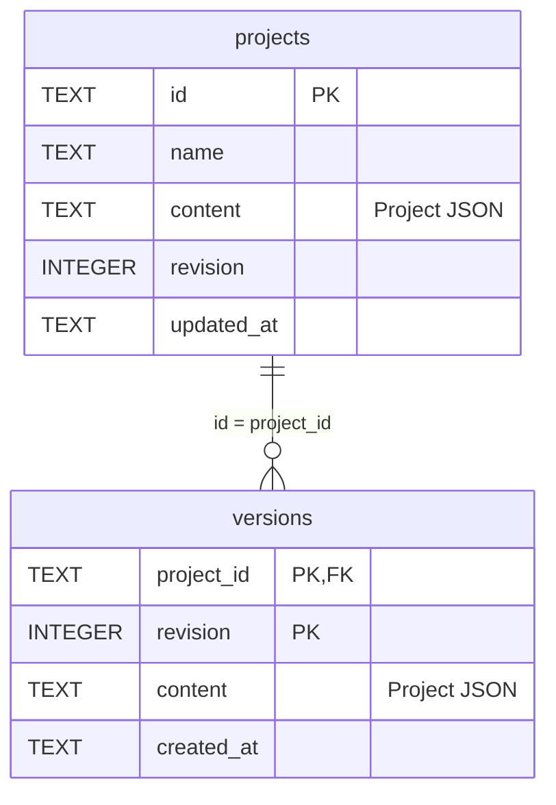

# ViewX Studio SQLite 資料儲存規格

整理日期：2026-10-12。程式基準：`77b129f`（已含 Popup、繼承、18 種元件與系統變數）。

已核對 `server/ProjectStore.cs` 的 DDL／讀寫程式，以及本機 `.data/viewx.db` 的唯讀 `sqlite_master`、`table_info`、`foreign_key_list`、`index_list`。目前兩者一致，只有 **2 張業務資料表、9 個實體欄位**。以下描述現行實作。

## 儲存方式與關係

| 資料表 | 用途 | 每筆代表 |
| --- | --- | --- |
| `projects` | 最新專案內容及目前版本 | 一個專案的最新完整快照 |
| `versions` | 不覆寫的版本紀錄 | 一個專案的一次儲存快照 |



畫面、元件、變數、圖片資源與警報規則都在 `content`，沒有各自的 SQL 資料表。`schemaVersion` 是 JSON 格式版本，`revision` 是某個專案的儲存版本，兩者意義不同。

## projects 欄位規格

| 欄位 | SQLite 型別 | SQL 約束 | 應用程式規則／來源 | 用途 |
| --- | --- | --- | --- | --- |
| `id` | TEXT | PRIMARY KEY；DDL未另外寫NOT NULL | API要求非空字串，必須等於請求路徑ID及 `content.id`；前端一般產生UUID | 專案識別碼 |
| `name` | TEXT | NOT NULL | 取自 `content.name`；現行驗證要求字串，沒有SQL長度或唯一性限制 | 專案列表顯示名稱 |
| `content` | TEXT | NOT NULL | `project.GetRawText()`，儲存整個Project JSON，包含可選欄位與未被拒絕的擴充欄位 | 最新專案快照 |
| `revision` | INTEGER | NOT NULL | 每個專案獨立計數，首次保存為1，每次成功保存加1 | 版本控制、避免過期寫入 |
| `updated_at` | TEXT | NOT NULL | 伺服器產生UTC時間，格式 `yyyy-MM-dd'T'HH:mm:ss.fff'Z'` | 最後保存時間；列表降冪排序 |

所有欄位均無SQL預設值。`id` 在一般SQLite TEXT主鍵表中的 `PRAGMA table_info.notnull` 為0；非空ID是API驗證規則。DDL未設定UUID格式、JSON有效性、版本正數或時間格式的CHECK，這些資料由應用層產生／驗證。

## versions 欄位規格

| 欄位 | SQLite 型別 | SQL 約束 | 應用程式規則／來源 | 用途 |
| --- | --- | --- | --- | --- |
| `project_id` | TEXT | NOT NULL；FK→`projects.id`；複合PK第1欄 | 等於該次保存的 `project.id` | 所屬專案 |
| `revision` | INTEGER | NOT NULL；複合PK第2欄 | 與同次保存後的 `projects.revision` 相同 | 該快照版本號 |
| `content` | TEXT | NOT NULL | 與同次保存的 `projects.content` 完全相同 | 當時完整專案，包含當時圖片 |
| `created_at` | TEXT | NOT NULL | 與同次保存的 `projects.updated_at` 使用同一UTC時間字串 | 版本建立時間 |

主鍵為 **(`project_id`, `revision`)**，不同專案可各自有版本1、2、3…。外鍵使用 `ON DELETE CASCADE`：若刪除專案列，相關版本列也刪除；目前API沒有提供刪除專案路由。版本列在現行程式中只有新增與讀取，沒有更新、刪除或定期清除流程。

## 實際建表 SQL

```sql
PRAGMA journal_mode=WAL;

CREATE TABLE IF NOT EXISTS projects (
    id TEXT PRIMARY KEY,
    name TEXT NOT NULL,
    content TEXT NOT NULL,
    revision INTEGER NOT NULL,
    updated_at TEXT NOT NULL
);

CREATE TABLE IF NOT EXISTS versions (
    project_id TEXT NOT NULL REFERENCES projects(id) ON DELETE CASCADE,
    revision INTEGER NOT NULL,
    content TEXT NOT NULL,
    created_at TEXT NOT NULL,
    PRIMARY KEY(project_id, revision)
);
```

| 索引／連線設定 | 現況 |
| --- | --- |
| projects主鍵索引 | SQLite自動建立唯一索引 `sqlite_autoindex_projects_1` |
| versions主鍵索引 | SQLite自動建立唯一索引 `sqlite_autoindex_versions_1`，順序為project_id、revision |
| 其他業務索引 | 無；`updated_at` 沒有獨立排序索引 |
| 外鍵 | C#連線字串 `ForeignKeys=true`，每條應用程式連線啟用 |
| Journal | WAL，允許讀寫並行 |
| 等待逾時 | `DefaultTimeout=5` 秒 |
| 連線池 | `Pooling=false`；每個操作建立自己的連線 |
| 建表／遷移 | 啟動時 `CREATE TABLE IF NOT EXISTS`；沒有SQL migration資料表或ALTER TABLE流程 |

## content：Project JSON 根欄位

本節以下都是 **JSON欄位，不是SQL欄位**。「必要」表示現行模型的必填欄位；可選欄位一般省略，不使用null。部分引用與量程可保存未完成草稿，執行前再由專案檢查確認。

| JSON路徑 | 型別 | 必要 | 規格／用途 |
| --- | --- | --- | --- |
| `schemaVersion` | number | 是 | 固定1，格式版本 |
| `id` | string | 是 | 專案ID；API驗證與路徑ID一致 |
| `name` | string | 是 | 專案名稱，同步寫入projects.name |
| `description` | string | 是 | 專案說明 |
| `startScreenId` | string | 是 | 必須指向存在的一般畫面；Popup不可作起始畫面 |
| `screens` | Screen[] | 是 | 至少一張畫面；畫面與元件都在此 |
| `variables` | Variable[] | 是 | 自訂變數定義，可為空陣列 |
| `assets` | ImageAsset[] | 否 | 共用圖片資源，最多100張 |
| `autoSave` | boolean | 否 | 自動儲存開關，省略時預設關閉 |

專案revision、updated_at不在Project模型內，由SQL欄位與API外層提供。專案內變數、畫面及元件ID必須非空且彼此唯一；圖片ID使用獨立唯一集合，警報規則ID在各元件內唯一。

### screens[]：畫面與Popup／繼承

| JSON路徑（每張畫面） | 型別 | 必要 | 規格／用途 |
| --- | --- | --- | --- |
| `id` | string | 是 | 畫面ID |
| `name` | string | 是 | 畫面名稱 |
| `width`／`height` | number | 是 | 畫面尺寸，各100～4096 |
| `background` | string | 是 | 背景顏色 |
| `type` | string | 否 | `normal`／`popup`；相容 `screen`／`dialog`。省略視為一般畫面 |
| `parentScreenId` | string | 否 | 父畫面引用，必須存在且不能循環 |
| `inheritsScreenId` | string | 否 | 舊版父畫面欄位；若兩欄同時存在，值必須相同；新介面修改時轉用parentScreenId |
| `elements` | Element[] | 是 | 該畫面自己擁有的元件，最多2000個；**不複製繼承元件** |

Popup堆疊、目前開啟對話盒、導航歷程屬於執行狀態，不放在screens[]。父畫面修改後，子畫面依引用即時合成；版本還原會一併還原當时的父畫面與子畫面內容。

### variables[]：自訂變數

| 欄位 | 型別 | 必要 | 用途 |
| --- | --- | --- | --- |
| `id` | string | 是 | 元件綁定使用的識別碼 |
| `name` | string | 是 | 顯示名稱 |
| `type` | string | 是 | `number`／`boolean`／`string` |
| `initial` | number／boolean／string | 是 | 型別必須符合type；number須有限；保存的是初始值 |
| `category` | string | 否 | 分類名稱；目前模型提供此欄位，現行SQL／API結構驗證未獨立檢查其型別 |

`$SYS.*` 系統變數在程式中定義及即時計算，不會另外產生SQL列，也不會自動加入variables[]；元件的variableId可保存系統變數識別碼。

### assets[]：共用圖片

| 欄位 | 型別 | 必要 | 規格／用途 |
| --- | --- | --- | --- |
| `id` | string | 是 | 唯一圖片資源ID |
| `name` | string | 是 | 去除空白後不可為空，最多200字元 |
| `data` | string | 是 | `data:image/{png|jpeg|webp|gif};base64,...`；API字串長度上限4×1024×1024＋30字元 |

圖片用Base64文字存在JSON中，不是BLOB欄位。前端單張檔案上限3 MiB；資源嵌入每次完整快照，因此不同版本可保留不同圖片內容。圖片去重與引用管理由前端處理，SQL沒有圖片hash欄位或資源資料表。

### elements[]：元件基本與動作欄位

| 欄位 | 型別 | 必要 | 用途／限制 |
| --- | --- | --- | --- |
| `id`／`name` | string | 是 | 元件識別碼／名稱 |
| `kind` | string | 是 | text、rectangle、circle、line、image、button、indicator、number、input、switch、gauge、bar、trend、alarm、datetime、multistate、scale、table |
| `x`／`y` | number | 是 | 座標，須有限且≥0；超出畫面由執行前檢查提示 |
| `width`／`height` | number | 是 | >0且≤4096 |
| `text` | string | 是 | 文字或標籤 |
| `color`／`background` | string | 是 | 文字／背景顏色 |
| `fontSize` | number | 是 | 8～1000 |
| `locked`／`visible` | boolean | 是 | 編輯鎖定／顯示設定 |
| `action` | string | 是 | toggle、set、increment、screen、reset、momentary、previousScreen、popup、closePopup；相容openDialog、closeDialog |
| `actionValue` | string | 是 | 設值或增減量；數字／布林以字串保存，由動作規則解析 |
| `variableId` | string | 否 | 綁定自訂或系統變數 |
| `targetScreenId` | string | 否 | 跳畫面或開啟Popup的目標ID；執行前檢查畫面類別 |
| `conditionId`／`enabledId` | string | 否 | 顯示／啟用條件，執行前要求有效布林來源 |
| `groupId` | string | 否 | 編輯群組ID；群組不是SQL資料表 |
| `imageAssetId` | string | 否 | 必須指向存在的assets[]圖片 |
| `image` | string | 否 | 相容舊元件內嵌data:image圖片，不需assets[] |

### elements[]：可選設定欄位

以下欄位皆可省略，不同kind只使用相關設定。表中範圍是現行格式驗證限制；量程大小、輸入初始值等組合規則另在執行前檢查。

| 群組 | 欄位 | 型別／可接受值 |
| --- | --- | --- |
| 數值 | `unit`、`numberPrefix` | string |
| 數值 | `decimals` | integer，0～6 |
| 數值 | `numberFormat` | decimal／integer／percent／scientific |
| 數值 | `numberLocale` | en-US／zh-TW／de-DE |
| 數值 | `useGrouping` | boolean |
| 輸入 | `inputMin`、`inputMax` | 有限number |
| 輸入 | `inputStep` | 有限number，>0 |
| 量程 | `scaleMin`、`scaleMax`、`warningThreshold`、`criticalThreshold` | 有限number |
| 量程 | `fillColor`、`trackColor` | 六位hex色碼，例如#38bdf8 |
| 長條 | `orientation` | horizontal／vertical |
| 儀表／長條 | `showValue`、`showScale` | boolean |
| 趨勢 | `sampleInterval` | integer，100～60000 ms |
| 趨勢 | `historyPoints` | integer，10～600 |
| 警報 | `alarmRules` | AlarmRule[]，最多20筆 |
| 警報 | `alarmMaxRows` | integer，1～100 |
| 文字 | `fontFamily` | 非空string，最多200字元 |
| 文字 | `fontWeight` | normal／bold |
| 文字 | `italic`、`underline`、`wordWrap`、`textBackground` | boolean |
| 文字 | `textAlign` | left／center／right |
| 文字 | `verticalAlign` | top／middle／bottom |
| 文字 | `lineHeight` | number，1～3 |
| 邊框 | `borderWidth` | number，0～20 |
| 邊框 | `borderRadius` | number，0～1000 |
| 邊框 | `borderColor` | 六位hex色碼 |
| 邊框 | `borderStyle` | none／solid／dashed／dotted |
| 圖形 | `shapeFilled` | boolean |
| 圖片 | `imageFit` | contain／cover／fill／none |
| 圖片 | `imagePosition` | center／top／bottom／left／right |
| 按鈕 | `buttonHoverBackground`、`buttonHoverColor`、`buttonPressedBackground`、`buttonPressedColor`、`buttonDisabledBackground`、`buttonDisabledColor` | 六位hex色碼 |
| 日期時間 | `dateTimeFormat` | string，最多100字元 |
| 多狀態 | `multistateItems` | MultistateItem[]，最多20筆 |
| 刻度 | `scaleOrientation` | horizontal／vertical |
| 刻度 | `scaleMajorTicks` | integer，1～50 |
| 刻度 | `scaleMinorTicks` | integer，0～50 |
| 刻度 | `scaleShowAxis`、`scaleShowLabels` | boolean |
| 表格 | `tableCols`、`tableRows` | integer，1～50 |
| 表格 | `tableDiagonal` | boolean |
| 格線 | `gridColor` | 六位hex色碼 |

| 子物件 | 欄位 | 必要 | 規格 |
| --- | --- | --- | --- |
| AlarmRule | `id` | 是 | 非空string，同一元件內不可重複 |
| AlarmRule | `message`、`variableId` | 是 | string，訊息／綁定變數 |
| AlarmRule | `operator` | 是 | gt／gte／lt／lte／eq／ne／true／false |
| AlarmRule | `severity` | 是 | info／warning／critical |
| AlarmRule | `threshold` | 否 | 有限number；數值警報執行前要求門檻 |
| AlarmRule | `enabled` | 否 | boolean，省略視為啟用 |
| MultistateItem | `value` | 是 | 有限number |
| MultistateItem | `label` | 是 | string，最多50字元 |
| MultistateItem | `color` | 是 | 六位hex色碼 |
| MultistateItem | `textColor` | 否 | 六位hex色碼；前端有驗證，現行C#驗證器尚未檢查此欄位 |

## content 範例（可保存的最小專案）

```json
{
  "schemaVersion": 1,
  "id": "project-001",
  "name": "產線監控",
  "description": "Popup 與母片示例",
  "startScreenId": "home",
  "autoSave": true,
  "variables": [
    {"id": "running", "name": "運轉", "type": "boolean", "initial": false}
  ],
  "assets": [],
  "screens": [
    {"id": "master", "name": "共通母片", "type": "normal", "width": 960, "height": 600, "background": "#101c2e", "elements": []},
    {"id": "home", "name": "主畫面", "type": "normal", "parentScreenId": "master", "width": 960, "height": 600, "background": "#101c2e", "elements": []},
    {"id": "confirm", "name": "確認對話盒", "type": "popup", "width": 480, "height": 300, "background": "#18263b", "elements": []}
  ]
}
```

同次保存會產生projects與versions兩份相同JSON；版本表不存差異補丁。此範例無按鈕，因此對話盒可在編輯器直接預覽；要從主畫面開啟需新增popup動作按鈕。

## 保存與還原規則

| 操作 | projects變化 | versions變化 |
| --- | --- | --- |
| 首次保存，客戶端revision=0 | 新增專案，revision=1 | 新增版本1 |
| 保存現有專案，客戶端revision=n | 覆寫最新快照，revision=n+1 | 新增版本n+1 |
| 還原舊版本k，目前版本n | 將版本k內容設為最新，revision=n+1 | 新增版本n+1；舊版本k及其他版本保留 |
| 客戶端revision已過期 | 不更新；HTTP409 | 不新增；整個交易回滾 |

保存使用立即寫入交易（`BeginTransaction(deferred:false)`），讀取目前revision、核對客戶端版本、寫入projects、寫入versions與提交在同一交易內完成。還原先取得不可變歷史快照，再以相同Save流程寫入。

API要求expected revision為非負整數且小於9,007,199,254,740,991；還原時expected revision至少1。每次成功保存都建立新版本，包括手動與自動儲存；資料庫沒有差異比較、版本筆數上限或自動清除策略。

## 已保存／未保存的資料

| 資料 | SQLite是否保存 | 位置／生命週期 |
| --- | --- | --- |
| 專案名稱、說明、自動儲存開關 | 是 | content及部分projects欄位 |
| 畫面、Popup類別、母片引用 | 是 | content.screens[] |
| 元件位置、樣式、動作與綁定 | 是 | screens[].elements[] |
| 自訂變數定義與初始值 | 是 | content.variables[] |
| 圖片及共用圖片資源 | 是 | content.assets[]／元件image |
| 警報規則、趨勢取樣設定 | 是 | 元件設定 |
| 每次保存的完整專案快照 | 是 | versions |
| 模擬當下的變數值／按鈕操作結果 | 否 | 瀏覽器runtime values |
| `$SYS.*` 即時計算結果 | 否 | 系統變數服務 |
| 趨勢點、警報發生／確認／解除紀錄 | 否 | 本次模擬記憶體；重新開始或重設清除 |
| Popup堆疊、畫面導航歷程 | 否 | 模擬狀態 |
| 執行紀錄、編輯器復原重做、縮放／格線與選取 | 否 | 編輯器記憶體 |

## 檔案位置、容量與備份

| 項目 | 規格 |
| --- | --- |
| 開發／儲存庫預設位置 | 儲存庫根目錄 `.data/viewx.db` |
| 發布後預設位置 | 發布應用程式ContentRoot下 `.data/viewx.db` |
| 自訂路徑 | `VIEWX_DB_PATH`；相對路徑由伺服器程序工作目錄解析 |
| API請求上限 | 20 MiB，包含外層project及revision；不是SQLite TEXT欄位的DDL限制 |
| 時間 | 資料庫一律UTC，前端依裝置地區顯示；UTC+8顯示時需加8小時 |
| 版本容量 | 每版本保存完整JSON與圖片，容量隨保存次数成長 |
| 備份 | 運行中使用SQLite Online Backup API；或停止服務後完整備份。WAL模式不可只複製.db而忽略未checkpoint的WAL |

## 常用唯讀查詢

```sql
-- 專案列表
SELECT id, name, revision, updated_at
FROM projects ORDER BY updated_at DESC;

-- 各專案版本数量
SELECT project_id, COUNT(*) AS version_count, MAX(revision) AS latest_revision
FROM versions GROUP BY project_id;

-- JSON 格式與專案結構（需 SQLite JSON 函式支援）
SELECT id,
       json_extract(content, '$.schemaVersion') AS schema_version,
       json_array_length(content, '$.screens') AS screen_count,
       json_array_length(content, '$.variables') AS variable_count
FROM projects;

-- 展開所有畫面的 Popup 與母片設定
SELECT p.id AS project_id,
       json_extract(s.value, '$.id') AS screen_id,
       json_extract(s.value, '$.name') AS screen_name,
       COALESCE(json_extract(s.value, '$.type'), 'normal') AS screen_type,
       COALESCE(json_extract(s.value, '$.parentScreenId'),
                json_extract(s.value, '$.inheritsScreenId')) AS parent_screen_id
FROM projects AS p, json_each(p.content, '$.screens') AS s;
```

## 程式依據

- [ProjectStore.cs](../server/ProjectStore.cs)：建表、列表、保存交易、歷史查詢與還原。
- [Program.cs](../server/Program.cs)：資料庫路徑、20 MiB請求限制、API驗證及HTTP狀態。
- [model.ts](../src/model.ts)：Project／Screen／Element等JSON模型與前端驗證。
- [ProjectValidator.cs](../server/ProjectValidator.cs)：C#結構驗證。
- [screenRules.ts](../src/services/screenRules.ts)：Popup類別、繼承引用與循環檢查。
- [useSimulation.ts](../src/hooks/useSimulation.ts)、[useRuntimeData.ts](../src/hooks/useRuntimeData.ts)：未持久化的執行資料。
