# ViewGP 操作手冊

**工程工作台｜畫面規劃、離線模擬與設備監看**

適用對象：第一次使用 ViewGP 的操作人員、畫面設計人員及設備設定人員。

版本：ViewGP v0.2.0｜畫面基準：4d3fbf1｜更新日期：2026-10-12｜繁體中文。

本手冊使用「泵浦監控教學」示範。所有操作圖片均取自目前系統；設備 IP、數值與警報訊息為教學範例。第一次開啟系統可能看到「智慧產線監控」，名稱不同不影響操作位置。

**建議閱讀方式：**先讀第 1、2 章完成第一次操作；需要自行設計時再讀第 3～7 章。要連設備或管理警報，再讀第 8、9 章。

**教學檔案：**[泵浦監控教學.json](manual/examples/泵浦監控教學.json)。此檔預設使用內部變數，匯入後可直接離線測試，不會自動連接設備。

## 目錄

- [1　認識工作台](#chapter-01)
- [2　十分鐘快速上手](#chapter-02)
- [3　建立、開啟與儲存專案](#chapter-03)
- [4　畫面、Popup 與共通母片](#chapter-04)
- [5　加入元件與整理版面](#chapter-05)
- [6　變數、綁定與系統變數](#chapter-06)
- [7　預覽與離線模擬](#chapter-07)
- [8　全域警報、跑馬燈與歷史](#chapter-08)
- [9　Modbus TCP 與 COM／RTU 通訊](#chapter-09)
- [10　圖片資源管理](#chapter-10)
- [11　版本還原與備份](#chapter-11)
- [12　常見問題與排除方式](#chapter-12)
- [附錄 A　常用快捷鍵](#appendix-a)
- [附錄 B　18 種元件速查](#appendix-b)
- [附錄 C　功能範圍與管理者資訊](#appendix-c)

## 1　認識工作台

### 1.1 開啟系統

1. 使用 Chrome 或 Edge 開啟管理者提供的網址。
2. 若服務安裝在自己的電腦，常見網址是 http://localhost:3000；服務在其他電腦時，使用管理者提供的主機 IP 或網址。
3. 建議先使用桌面電腦與較寬的視窗。手機窄螢幕會縮小工具列，並隱藏右側屬性面板。
4. 看見 ViewGP、主選單、左右面板與中央畫布，即可開始操作。

一般使用者只需要瀏覽器，不需要自行安裝 Node.js 或 .NET。

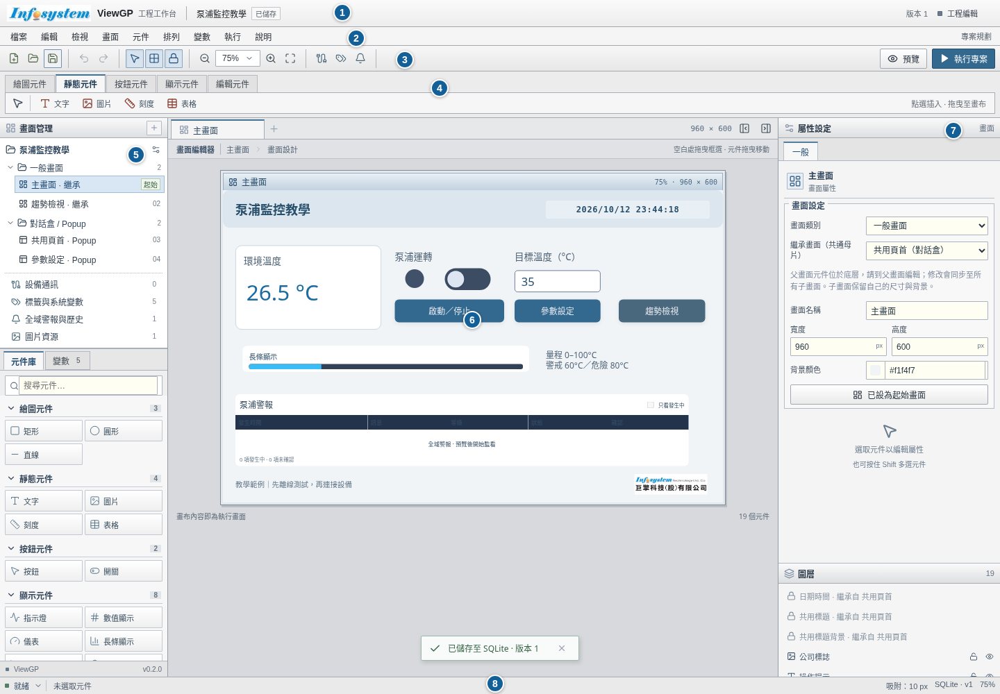

### 1.2 八個區域怎麼用

| 圖中編號 | 區域           | 日常用途                                                                   |
| -------- | -------------- | -------------------------------------------------------------------------- |
| 1        | 專案與狀態     | 查看專案名稱、是否修改、版本，以及編輯／模擬／設備連線狀態。               |
| 2        | 主選單         | 執行檔案、編輯、畫面、元件、排列、變數與執行命令。                         |
| 3        | 專案工具列     | 快速新增、開啟、儲存、復原、縮放、通訊、標籤與警報管理。滑鼠停留可看名稱。 |
| 4        | 分類元件工具列 | 切換五大類元件，點選插入，或拖曳到畫布。                                   |
| 5        | 專案樹與元件庫 | 選擇一般畫面／Popup；進入設備、標籤、警報與圖片管理；搜尋要加入的元件。    |
| 6        | 畫布           | 排列元件；執行時操作畫面中的按鈕、開關及輸入欄位。                         |
| 7        | 屬性／監看區   | 編輯時設定目前選取的畫面或元件；執行時查看與修改模擬變數。                 |
| 8        | 狀態列         | 查看選取數量、吸附、縮放、保存與警報歷史狀態；可開啟執行紀錄。             |

**看不見面板時：**按中央畫面頁籤右側的面板切換圖示，或從「檢視」重新顯示左側面板／屬性面板。

### 1.3 先分清三件事

| 名稱       | 意思                                     | 例子                                 |
| ---------- | ---------------------------------------- | ------------------------------------ |
| 畫面       | 放置元件的一個頁面。                     | 主畫面、趨勢檢視。                   |
| 元件       | 畫面上的顯示或操作物件。                 | 按鈕、指示燈、數值顯示。             |
| 變數／標籤 | 保存數值、開關或文字，讓元件讀取或操作。 | 「溫度」被數值顯示、長條及趨勢共用。 |

例如：「啟動／停止」按鈕修改「運轉狀態」變數；同一個變數控制指示燈與開關。只放按鈕，沒有綁定變數，不會產生這個關聯。

## 2　十分鐘快速上手

### 2.1 先體驗完整教學專案

1. 取得手冊附帶的「泵浦監控教學.json」。
2. 選「檔案 → 匯入專案…」，選取該 JSON 檔。
3. 確認專案名稱為「泵浦監控教學」，左側有「主畫面」與「趨勢檢視」。
4. 按工具列「儲存專案」。底部應出現保存版本，不再顯示「尚未儲存」。
5. 按「執行專案」。上方應顯示「離線模擬」。
6. 按畫面中的「啟動／停止」；指示燈變亮，右側「運轉狀態」變成 TRUE。再按一次會關閉。
7. 在右側「溫度」輸入 70；數值顯示、長條與趨勢會使用同一個值。
8. 按「參數設定」，在 Popup 輸入 40，按 Enter；再按「關閉」。
9. 按「趨勢檢視」查看曲線；按「回上一畫面」返回。
10. 按「停止執行」回到編輯模式。

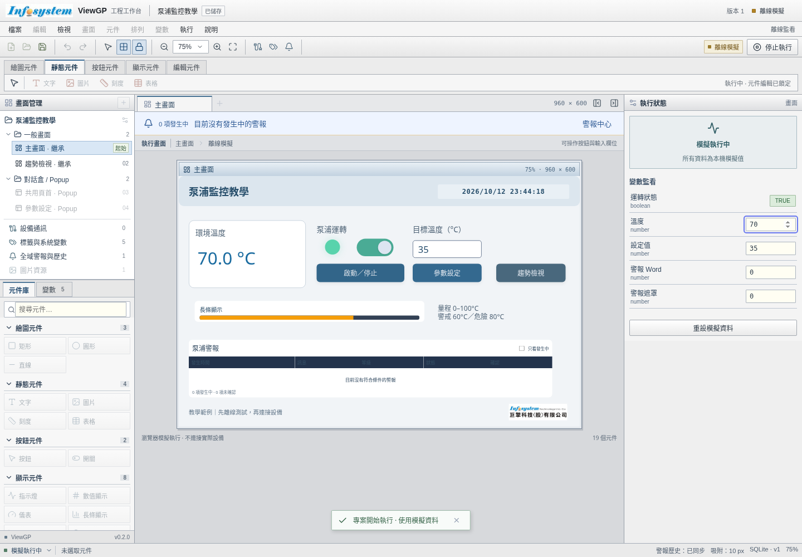

**做到這裡就已上手：**您已完成匯入、保存、變數操作、Popup 輸入及畫面切換。這些步驟都不會操作實際設備。

### 2.2 自己建立第一個小專案

以下只建立兩個變數、三個元件，適合練習。

| 要建立的變數 | 資料型別     | 初始值 |
| ------------ | ------------ | ------ |
| 運轉狀態     | 布林 boolean | false  |
| 溫度         | 數值 number  | 26.5   |

1. 按「新增專案」，再到「檔案 → 專案設定」將名稱改為「我的第一個監控畫面」。
2. 到「變數 → 新增變數」，依上表建立兩個變數。
3. 切回左側「元件庫」，加入「按鈕」。選取它，設定文字「啟動／停止」，動作「切換開關 (Toggle)」，綁定「運轉狀態」。
4. 加入「指示燈」，綁定「運轉狀態」。
5. 加入「數值顯示」，綁定「溫度」，小數位數 1，單位 °C。
6. 將三個元件拖開，不要重疊。按「儲存專案」，再按「執行專案」。
7. 按按鈕，看指示燈切換；修改右側溫度，看顯示值同步改變。

新增專案會開啟空白畫面與空白變數清單。教學完整範例另包含設定值、警報 Word、遮罩、Popup、母片及趨勢，不必一次全部建立。

## 3　建立、開啟與儲存專案

### 3.1 設定專案

入口：「檔案 → 專案設定」，或專案樹名稱旁的設定圖示。

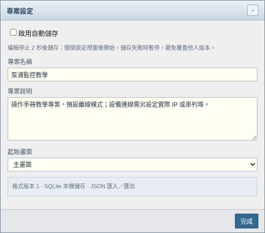

| 欄位         | 怎麼填                                            |
| ------------ | ------------------------------------------------- |
| 專案名稱     | 使用容易辨識的名稱，例如「一號泵浦監控」。        |
| 專案說明     | 記錄用途、設備或維護資訊。                        |
| 起始畫面     | 執行完整專案時先開啟的一般畫面。不能選 Popup。    |
| 啟用自動儲存 | 勾選後，關閉設定視窗；編輯停止約 2 秒後自動保存。 |

設定欄位會即時套用到編輯內容；關閉設定視窗本身不表示已保存，仍須按儲存或確認自動儲存完成。

### 3.2 開啟及另存

- **開啟既有專案：**按「開啟專案」，從清單選取。
- **儲存目前專案：**按工具列磁碟圖示「儲存專案」。
- **保留原案再修改：**選「檔案 → 另存新專案」；另存後目前操作會轉到新的專案。
- **未儲存提醒：**名稱旁的修改標示／小點及底部「尚未儲存」表示內容仍需保存。

重新整理網頁後，請從「開啟專案」載入已保存的專案。目前沒有自動恢復未儲存草稿的功能。

### 3.3 JSON 匯入與匯出

1. 分享或備份目前設計：選「檔案 → 匯出專案」，瀏覽器會下載 JSON。
2. 載入檔案：選「檔案 → 匯入專案…」並選取 JSON。
3. 匯入後按「儲存專案」，才能加入系統的專案清單。

匯入會作為新專案處理，避免直接覆蓋原專案。JSON 包含畫面、元件、變數、圖片及設備／警報設定，**不包含版本清單、警報歷史與執行中的數值**。這些保存差異在第 11 章說明。

## 4　畫面、Popup 與共通母片

### 4.1 一般畫面

入口：「畫面 → 新增畫面」，或左側畫面管理的＋按鈕。

1. 建立新畫面後，選「畫面 → 重新命名 / 畫面設定」。
2. 設定名稱、寬度、高度與背景。
3. 用左側專案樹切換要編輯的畫面。
4. 要讓某畫面先開啟，選「畫面 → 設定為起始畫面」。

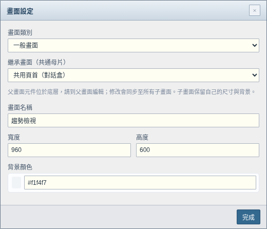

畫面尺寸範圍為 100～4096 像素。縮放只改變編輯器的觀看倍率，不會改變畫面本身的寬高。若畫面太大，按「符合畫面」，或在中央區域捲動。

### 4.2 畫面切換按鈕

1. 在主畫面新增「按鈕」。
2. 在右側「資料」設定動作「切換畫面 (Jump)」。
3. 指定目標一般畫面，例如「趨勢檢視」。
4. 目標畫面可新增動作為「回上一畫面 (Return)」的按鈕。

導航按鈕不需要綁定數值／布林變數。沒有切換紀錄時，回上一畫面會提示已無上一畫面。

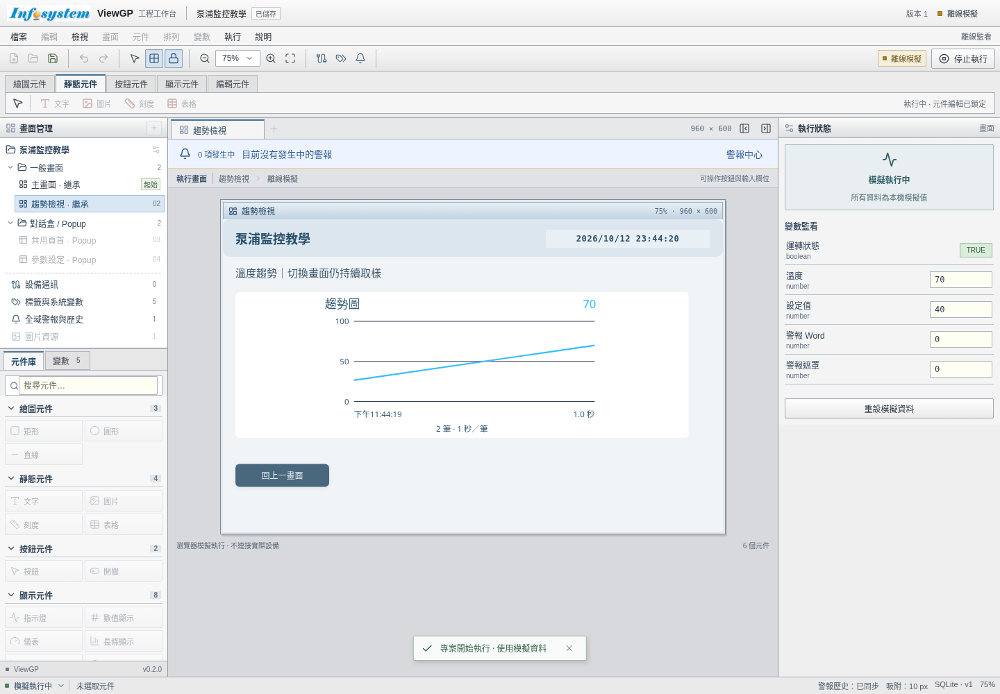

### 4.3 Popup：彈出式對話盒

1. 選「畫面 → 新增對話盒」。
2. 命名為「參數設定」，設定尺寸，例如 460 × 280。
3. 在 Popup 加入數值輸入，綁定「設定值」；加入動作為「關閉對話盒」的按鈕。
4. 回主畫面，加入按鈕「參數設定」，動作選「開啟對話盒」，指定此 Popup。
5. 預覽／執行後，按該按鈕測試。

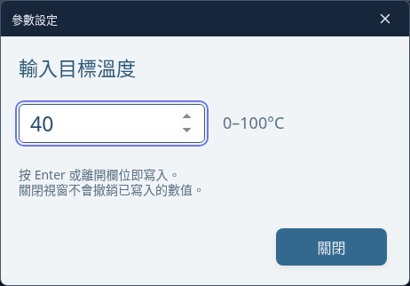

- Popup 開啟時，背景與下層對話盒的操作會被阻擋。
- 可用視窗右上角關閉鍵、關閉按鈕或 Esc 關閉最上層。輸入欄位內的 Esc 用來取消暫存輸入；要關閉視窗可按關閉鍵。
- 可巢狀開啟，最多 16 層，同一對話盒不能重複開啟。
- **數值輸入按 Enter 或離開欄位時已寫入。關閉 Popup 不會撤銷已寫入的值。**目前沒有「最後按確定才一次提交所有欄位」的交易機制。
- 直接預覽 Popup 時，系統會以專案起始畫面作為背景。

### 4.4 共通母片：一次修改，多個畫面共用

適合放共用頁首、日期時間、導覽按鈕或固定背景。

1. 建立「共用頁首」畫面。可使用一般畫面或 Popup；教學範例使用 Popup。
2. 在母片放入標題、底圖或時間／日期元件。
3. 選取子畫面，例如「主畫面」。
4. 在「繼承畫面（共通母片）」選擇「共用頁首」。
5. 對其他需要相同頁首的畫面重複步驟 3、4。

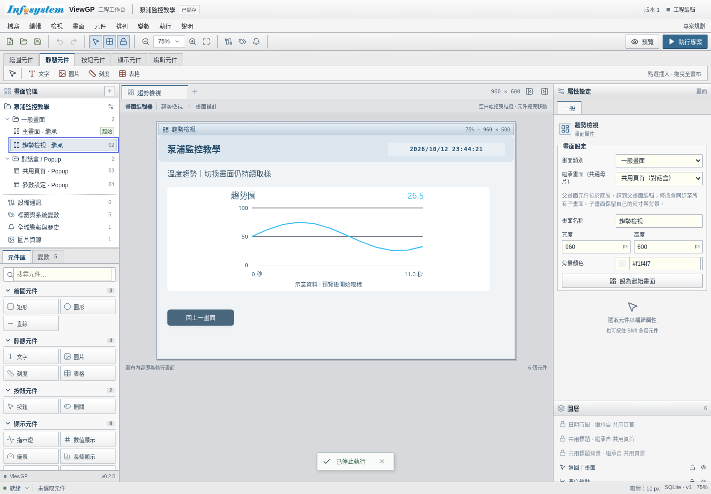

母片元件會放在子畫面底層，子畫面的自己的元件放在上層。修改母片會同步反映到子畫面，子畫面仍使用自己的尺寸與背景。

繼承元件不能直接在子畫面拖曳、刪除或改屬性。請從專案樹開啟母片，或點右側圖層的繼承來源，前往母片編輯。

**遇到無法刪除畫面：**先檢查是否仍被其他畫面繼承，或被導航按鈕引用。要刪除時先解除引用。母片不能形成循環繼承。

## 5　加入元件與整理版面

### 5.1 三種加入方式

編輯元件前，先按「停止執行」回到編輯模式。

- 上方分類元件工具列：切換分類，點選元件。
- 左側元件庫：點選元件，或拖曳到畫布指定位置。
- 「元件」選單：依分類選擇要加入的元件。

上方分類頁籤可用左右方向鍵、Home、End 切換。元件庫的分類可以收合，也可以用搜尋框輸入中文名稱、分類或英文種類。

### 5.2 選取、移動及調整大小

1. 點元件選取；選取框四角會出現控制點。
2. 拖曳元件移動，或拖曳四角控制點調整大小。
3. 需要精確位置時，在右側「一般」輸入 X、Y、寬度、高度。
4. 多選時按住 Shift 點選元件；也可在空白處拖曳框選完整落入框內的元件。
5. 按 Esc 清除選取；Delete 刪除選取的未鎖定元件。

格線可從工具列開關。吸附開啟時以 10 px 格線定位；需要精細拖曳可先關閉吸附，或直接輸入座標。

### 5.3 右側屬性怎麼看

| 區段 | 常用設定                                                     |
| ---- | ------------------------------------------------------------ |
| 一般 | 名稱、X／Y 座標、寬度、高度。                                |
| 外觀 | 文字、字型、顏色、邊框、圓角、圖片顯示方式。                 |
| 資料 | 綁定變數、按鈕動作、數值格式或輸入限制。                     |
| 進階 | 量程、趨勢／警報設定、顯示與啟用條件、鎖定。依元件種類不同。 |

上方區段按鈕會將右側捲動到該設定區，不會切換成另一組資料。也可右鍵點元件，開啟「元件屬性設定」視窗。

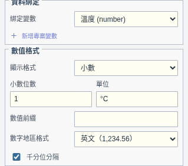

修改即時套用，按「復原」可回到前一步。多選時，右側顯示其中一個元件的屬性；修改會套用到選取且允許編輯的元件。

### 5.4 排列、群組與圖層

| 工作           | 操作                                                |
| -------------- | --------------------------------------------------- |
| 元件排成一直線 | 多選後使用「排列 → 靠左／靠右／靠上／靠下對齊」。   |
| 間隔一致       | 多選後使用「水平等距」或「垂直等距」。              |
| 大小一致       | 多選後使用「相同寬度」或「相同高度」。              |
| 一起移動       | 多選後使用「排列 → 群組」；需要分開時「取消群組」。 |
| 調整遮蓋順序   | 使用上一層、下一層、移至最上層／最下層。            |
| 防止誤移動     | 鎖定元件；需要修改時先解鎖。                        |
| 暫時隱藏元件   | 右側圖層按眼睛圖示，或取消「顯示元件」。            |

群組會一起選取及移動。鎖定不是登入權限控制，而是編輯器的防誤移動功能。

## 6　變數、綁定與系統變數

### 6.1 新增變數

入口：「變數 → 新增變數」，或左側「變數」頁籤中的新增按鈕。

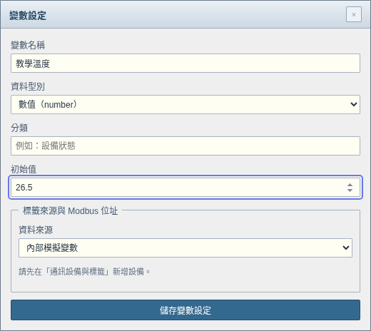

| 欄位     | 範例與說明                                              |
| -------- | ------------------------------------------------------- |
| 變數名稱 | 教學溫度；同一專案不能重複名稱。                        |
| 資料型別 | number 數值、boolean 布林、string 文字。                |
| 分類     | 可填「泵浦」或「警報」，方便搜尋及辨識。                |
| 初始值   | 開始或重設離線模擬時使用的值。型別要與變數一致。        |
| 資料來源 | 留在「內部模擬變數」即可先測試；設備映射在第 9 章設定。 |

完成後按「儲存變數設定」。要編輯既有變數，進左側「變數」頁籤，點變數的設定圖示。

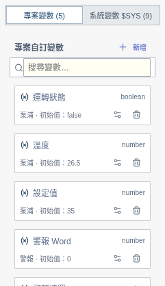

### 6.2 把元件綁定到變數

1. 選取畫布上的元件。
2. 點右側「資料」快速定位。
3. 在「綁定變數」選擇變數。
4. 儲存後預覽／執行，查看變數改變是否反映到元件。

系統會列出適用型別：指示燈／開關通常綁定布林；數值顯示、輸入、儀表、長條及趨勢綁定數值。文字元件可顯示文字或其他變數內容。

變數仍被元件、條件或警報引用時不能刪除；先解除相關綁定。改資料型別後，也應重新確認元件及設備映射。

### 6.3 按鈕動作

| 動作              | 結果                    | 常用例子             |
| ----------------- | ----------------------- | -------------------- |
| 切換開關 Toggle   | TRUE 與 FALSE 互換。    | 啟動／停止。         |
| 點動 Momentary    | 按住時 ON，放開時 OFF。 | 手動寸動。           |
| 設定值 Set        | 將指定值寫入綁定變數。  | 設定目標、寫入命令。 |
| 加減數值 Step     | 目前值加上正數或負數。  | ＋1、－1。           |
| 重設 Reset        | 此變數回到初始值。      | 清零／回預設。       |
| 切換畫面 Jump     | 開啟指定一般畫面。      | 趨勢頁。             |
| 回上一畫面 Return | 回到先前切換的畫面。    | 返回。               |
| 開啟／關閉對話盒  | 操作 Popup。            | 參數設定。           |

「重設」按鈕只重設綁定變數；右側「重設模擬資料」會重新開始整個模擬、回到初始值並清空本次趨勢／即時紀錄。

### 6.4 數值輸入

1. 綁定數值變數，填最小值、最大值及步距；留白表示不限制。
2. 教學範例設定 0～100、步距 0.5，允許 35、35.5、40 等值。
3. 執行時先輸入暫存文字，按 Enter 或離開欄位才寫入。
4. Esc 取消本次尚未確認的輸入。
5. 超限、空白或不符合步距時會提示原因並回復原值。

最小值／步距是該輸入元件的限制，不是整個變數的全域限制。若別的按鈕或模擬監看欄直接修改同一變數，不會自動套用此元件的範圍。

### 6.5 系統變數

左側變數頁籤可切換「系統變數 $SYS」。這些值由系統更新，通常只用來顯示，不能用按鈕寫入。

| 系統變數                  | 用途                                         |
| ------------------------- | -------------------------------------------- |
| $SYS.TIME／DATE／DATETIME | 時間、日期、完整日期時間。                   |
| $SYS.CURRENT_SCREEN       | 目前畫面名稱。                               |
| $SYS.SCREEN_COUNT         | 畫面總數。                                   |
| $SYS.ACTIVE_ALARMS        | 發生中警報筆數。                             |
| $SYS.BUZZER               | 系統提供的狀態旗標；不等同已實作硬體蜂鳴器。 |
| $SYS.TICK_1S／TICK_500MS  | 1 秒／0.5 秒交替脈衝。                       |

「時間／日期」元件可直接顯示瀏覽器裝置時間，不一定要綁定變數。可選常用格式如 HH:mm:ss、YYYY-MM-DD、YYYY/MM/DD、YYYY-MM-DD HH:mm:ss、YYYY/MM/DD HH:mm:ss；沒有連到 PLC RTC 的自動校時功能。

## 7　預覽與離線模擬

### 7.1 兩種開始方式

| 按鈕     | 何時使用                                                  |
| -------- | --------------------------------------------------------- |
| 預覽     | 測試目前選取的畫面。預覽 Popup 時會自動放在起始畫面上方。 |
| 執行專案 | 從起始畫面開始完整操作，包括導航與 Popup。                |

預覽／執行會先做專案檢查。若開啟「專案檢查」視窗，請修正列出的項目再開始。

### 7.2 怎麼修改模擬值

1. 確認目前資料來源為「離線模擬」。
2. 按「執行專案」。
3. 在右側「變數監看」輸入數值；布林可按 TRUE／FALSE 切換。
4. 查看畫面中的指示燈、數值、儀表與長條是否同步改變。
5. 趨勢需要至少幾次取樣才看得到線段；教學範例每 1 秒取樣一次。
6. 完成後按「停止執行」。

開始／重設模擬會回到變數初始值，**模擬中改成 70 不會把專案初始值改成 70**。希望下次仍從 70 開始，要停止後修改變數定義的初始值，再保存專案。

### 7.3 檢查與執行紀錄

- 「執行 → 專案檢查」會指出失效綁定、型別不符、無效目標、超出畫面及設定問題。
- 底部點執行狀態，或「檢視 → 執行紀錄」，可查看按鈕與輸入操作紀錄。

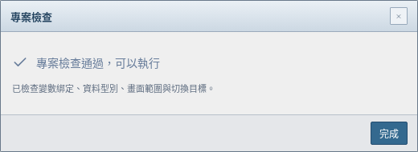

遇到綁定問題時，先回到編輯模式，選取提示中的元件，重新指定變數。先用離線模式確認畫面，再切換設備連線。

## 8　全域警報、跑馬燈與歷史

### 8.1 先認識 Word 與 Bit

一個 Word 是 16 位元整數，範圍 0～65535；每個 Bit 可以代表一個警報。

| Word 值 | 為 1 的位元  | 教學範例       |
| ------- | ------------ | -------------- |
| 0       | 無           | 沒有條件成立。 |
| 1       | Bit 0        | 泵浦過載。     |
| 4       | Bit 2        | 溫度過高。     |
| 5       | Bit 0＋Bit 2 | 兩項同時成立。 |

教學的「溫度過高」是由警報 Word 的 Bit 2 觸發，**不是因為右側溫度變成 70 就自動觸發**。若要直接比較溫度，可使用警報清單元件的數值規則。

### 8.2 建立全域警報

入口：「檔案 → 全域警報管理與歷史」，或工具列「開啟警報管理」。

1. 進「警報設定」，按「新增警報區」。系統會建立一個 Word 與一個遮罩變數。
2. 設定警報區名稱與群組。
3. 指定「警報 Word」及「遮罩 Word」。可改用既有數值變數；不需要遮罩時選「不使用遮罩」。
4. 設定檢查週期，例如 500 ms，並啟用警報區。
5. 為 Bit 0 填入「泵浦過載」、等級「嚴重」；新增 Bit 2，填「溫度過高」、等級「警告」。
6. 啟用警報跑馬燈，選上方或下方，輪播間隔例如 3000 ms。
7. 關閉視窗並保存專案。

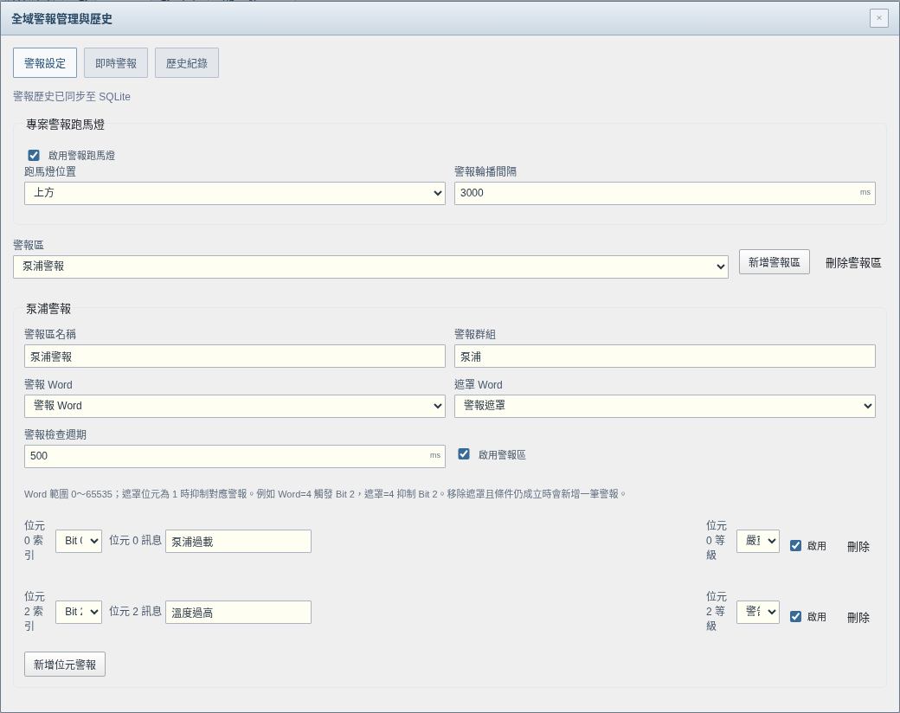

每區最多 16 個不重複位元；檢查週期 100～60000 ms；輪播間隔 1000～60000 ms。連續為 1 只保留同一筆發生事件，回到 0 後再次為 1 才新增事件。

### 8.3 測試觸發、遮罩與解除

以下使用教學檔案的「警報 Word」及「警報遮罩」。

1. **先保存專案，再執行。**
2. 右側將警報 Word 設為 5，遮罩維持 0。等待一個檢查週期，應出現兩項警報。
3. 開啟警報管理，切到「即時警報」，確認兩條訊息。
4. 將遮罩設為 4。Bit 2 被抑制，Bit 0 仍發生中。
5. 將遮罩改回 0；若 Word 仍是 5，Bit 2 會重新產生一筆警報。
6. 將 Word 改成 0，等待一個檢查週期，警報應解除。

**遮罩規則：**遮罩的某個位元為 1，就抑制相同索引的警報；它不會修改設備的警報 Word。

### 8.4 確認不是解除

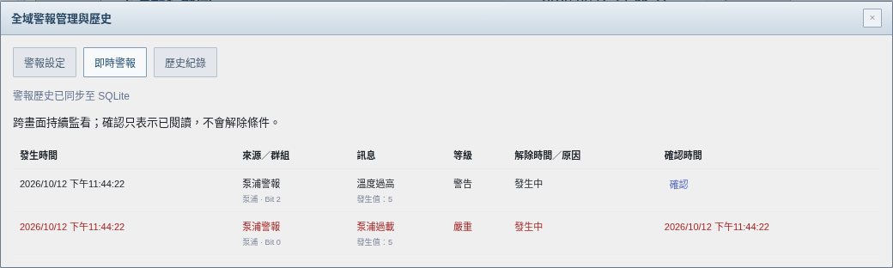

- **確認：**表示操作者已閱讀，記錄確認時間。
- **解除：**表示條件恢復、遮罩抑制或工作階段結束等原因。
- 條件仍存在時，按確認不會消除警報。
- 畫面上的警報清單可選此元件規則、全域警報或全部警報，並依群組篩選。

### 8.5 查詢歷史

1. 開啟警報管理，切到「歷史紀錄」。
2. 視需要填訊息／來源搜尋、等級、群組、開始及結束時間。
3. 按「查詢／重新整理」。
4. 查看發生、確認、解除時間與解除原因；利用分頁查看其他記錄。

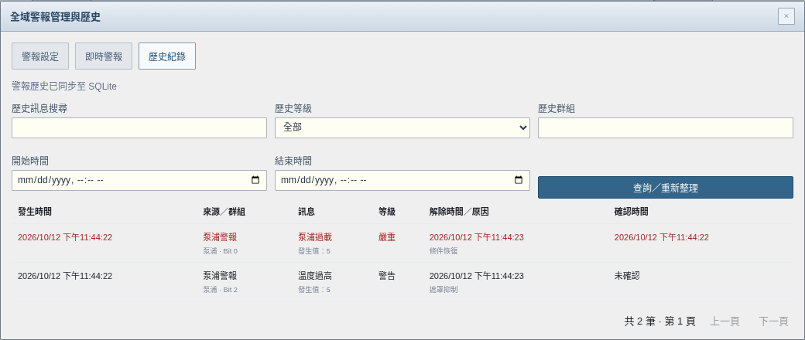

已保存專案的警報歷史存在後端資料庫，重啟後仍可查詢。沒有保存過的專案只在目前頁面暫存。

歷史保存失敗時可重試；待送資料仍在目前頁面記憶體，請等「警報歷史：已同步」再關閉。停止模擬／設備連線會結束工作階段；目前解除原因可能顯示「模擬結束」，這代表停止執行，並不表示設備故障已排除。

設備資料失效時，相關警報判斷暫停、原有警報保留；取得有效資料後才重新判斷。關閉網頁後不提供持續警報監控，這一點在連設備前須了解。

## 9　Modbus TCP 與 COM／RTU 通訊

### 9.1 先確認設備接在哪裡

**通訊由後端服務所在電腦執行。**瀏覽器看到的設備 IP 與 COM 埠，必須是後端可以存取的位置。

| 設備位置                           | 能否直接使用目前功能                                      |
| ---------------------------------- | --------------------------------------------------------- |
| 設備與後端同一區域網路，網路可達   | 可以使用 Modbus TCP。                                     |
| USB／RS-485 轉接器插在後端電腦     | 可以使用 Modbus RTU，另確認串列埠權限。                   |
| 設備只在使用者的遠端電腦或遠端內網 | 後端沒有路徑時不能直接連；需路由／VPN，或在現場執行後端。 |

此版本沒有遠端現場代理或瀏覽器 Web Serial。不同網段若已有路由仍可能連線；單純開得了網頁，不代表後端可以存取現場設備。

### 9.2 Modbus TCP 設備設定

入口：「檔案 → 通訊設備與標籤」或工具列通訊圖示。

1. 在「設備設定」按「新增設備」。
2. 設定名稱，例如 PLC 1；通訊協定選 Modbus TCP。
3. 填入後端可連線的設備 IP、Port、Unit ID。
4. 輪詢間隔可先設 500 ms，逾時先設 1000 ms。
5. 勾選啟用設備，接著設定標籤映射。

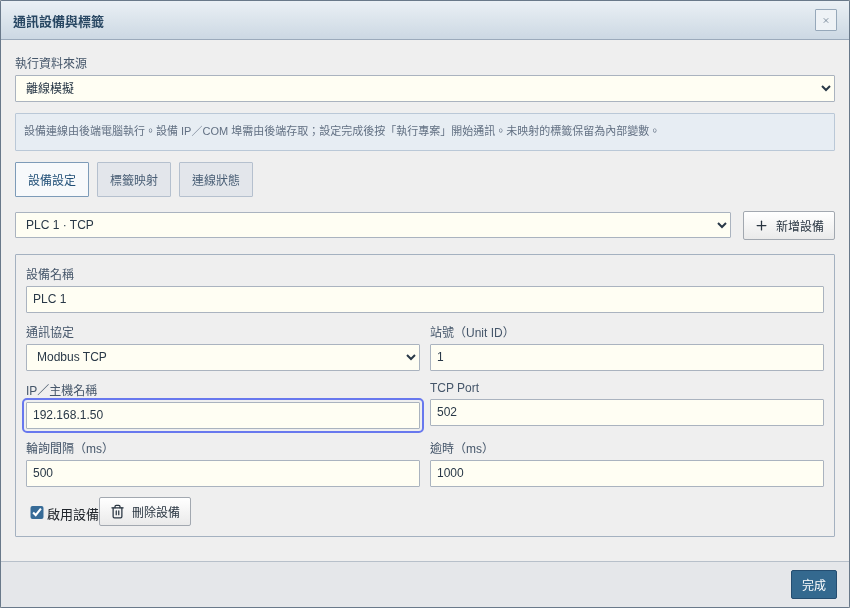

| 欄位         | 建議起點／說明                                             |
| ------------ | ---------------------------------------------------------- |
| IP／主機名稱 | 圖中 192.168.1.50 是範例，請換成實際設備。不要填 http://。 |
| TCP Port     | 通常 502，仍以設備設定為準。                               |
| 站號 Unit ID | 常用 1；TCP 可設 0～255，依設備手冊。                      |
| 輪詢間隔     | 100～60000 ms；較短表示更常更新，也增加通訊負載。          |
| 逾時         | 100～10000 ms，逾時會標記資料失效並在後續讀取重連。        |

只有設備設定還不會得到數值，必須至少有一個標籤映射到啟用的設備。

### 9.3 標籤位址映射

1. 切到「標籤映射」，搜尋要設定的變數，例如「溫度」。
2. 在「資料來源」選 PLC 1。
3. 選資料區、位址與資料型別。
4. 如需從畫面修改設備，將讀寫權限改成「讀寫」；新映射預設唯讀。
5. 數值可設定高低 Word 順序、倍率與偏移。

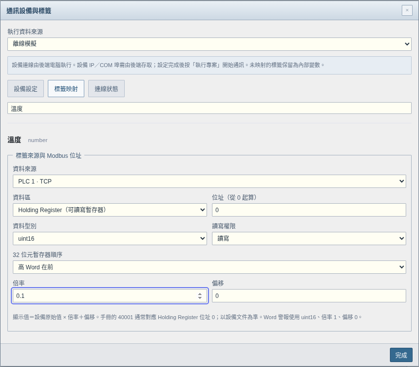

| 項目       | 教學範例                             |
| ---------- | ------------------------------------ |
| 資料區     | Holding Register。                   |
| 位址       | 0，採封包的 0 起算位址。             |
| 資料型別   | uint16，16 位元無號整數。            |
| 倍率／偏移 | 0.1／0。原始值 265 顯示成 26.5。     |
| 讀寫權限   | 讀寫；實際是否可寫也要符合設備手冊。 |

**最常見的位址錯誤：**設備手冊的 40001 通常對應 Holding Register 位址 0，不是把 40001 直接填進位址欄。30001 通常對應 Input Register 位址 0；廠商命名可能不同，請核對設備文件。

| 資料區           | 變數型別   | 是否可寫       |
| ---------------- | ---------- | -------------- |
| Coil             | 布林，bool | 可依權限讀寫。 |
| Discrete Input   | 布林，bool | 唯讀。         |
| Holding Register | 數值       | 可依權限讀寫。 |
| Input Register   | 數值       | 唯讀。         |

數值支援 uint16、int16、uint32、int32、float32；32 位元占兩個連續暫存器，需確認高／低 Word 順序。文字／ASCII 暫存器目前不提供映射。

Word 警報與遮罩必須使用 uint16、倍率 1、偏移 0。設定為溫度倍率的標籤不能直接當警報 Word。

### 9.4 COM／Modbus RTU 設定

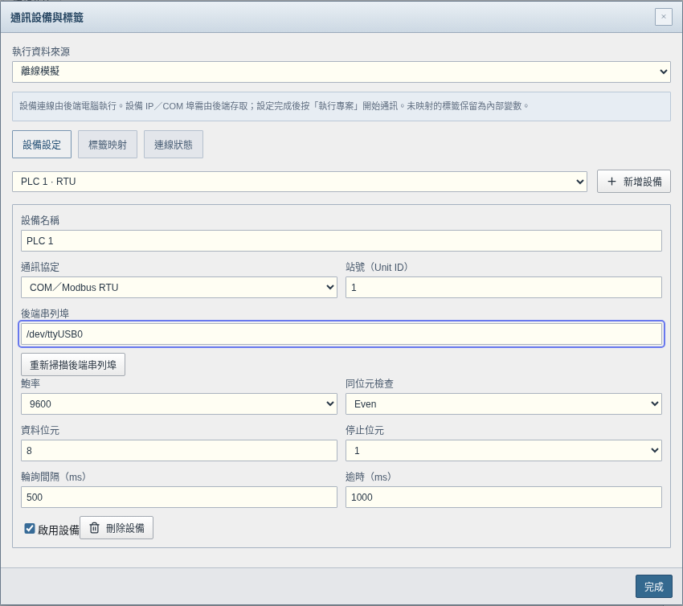

1. 在設備設定選 COM／Modbus RTU。
2. Windows 可填 COM3；Linux 可填 /dev/ttyUSB0 或 /dev/ttyACM0，以實際後端裝置名稱為準。
3. 可按「重新掃描後端串列埠」協助找埠，未列出時仍可手動輸入。
4. 設鮑率、None／Even／Odd、資料位元 8、停止位元 1 或 2，以及 RTU 站號 1～247。
5. 參數須與設備一致；RS-485 的接線、轉接器方向控制依設備及轉接器說明。
6. 用相同「標籤映射」流程設定資料區與位址。

目前一個啟用 RTU 設備使用一個串列埠；同埠多站輪詢尚未提供。同一埠也不能同時被其他程式或另一工作階段使用。Linux 執行後端的帳號須具備串列埠權限。

### 9.5 開始設備監看

1. 保存專案；確認設備與標籤設定完整。
2. 在「執行資料來源」選「設備連線（Modbus TCP／RTU）」。
3. 關閉視窗，按「執行專案」。
4. 頂端顯示設備連線；右側映射變數改成設備即時值。
5. 開「通訊設定與狀態／連線狀態」，查看已連線、錯誤及最後成功時間。
6. 完成後按「停止執行」，關閉此頁通訊工作階段。

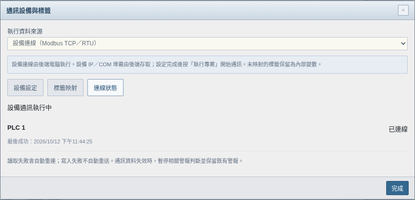

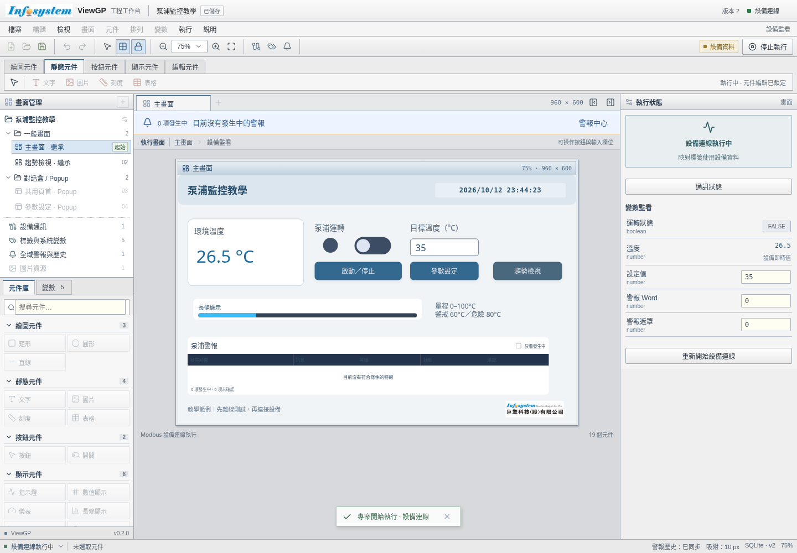

圖 19、20 使用本機教學模擬 PLC，127.0.0.1 與畫面中的連接埠不是您設備的固定設定。

每次開啟或匯入專案後，資料來源預設回到離線模式，需要重新確認連線選擇。沒有映射的變數在設備連線模式仍為內部變數。

### 9.6 寫入及通訊異常

- 映射標籤在右側監看區供讀取；要寫設備，使用已綁定的輸入、按鈕或開關。
- 唯讀或資料失效時，相關寫入控制會停用。不要把灰色按鈕誤認為程式當機。
- 寫入後會讀回設備實際值，畫面不會只因按下按鈕就假定已成功。
- 顯示「寫入未能確認」時，設備可能已接受指令，請查看實際設備；系統不會自動重送寫入。
- 整數寫入須在資料型別範圍內；倍率換算後也須為整數。例如倍率 0.1 的 uint16，可寫 26.5，不能寫 26.55。
- 斷線後會嘗試重新讀取／連線，資料失效不以 0 代替。相關警報保留。
- 網頁閒置／背景節流太久，工作階段可能被回收；停止後重新執行即可重新建立連線。
- 點動按鈕放開會嘗試寫 OFF；瀏覽器強制關閉或設備斷線不能保證 OFF 送達，設備端須自行處理命令逾時與互鎖。

## 10　圖片資源管理

入口：「檔案 → 圖片資源管理」或專案樹「圖片資源」。

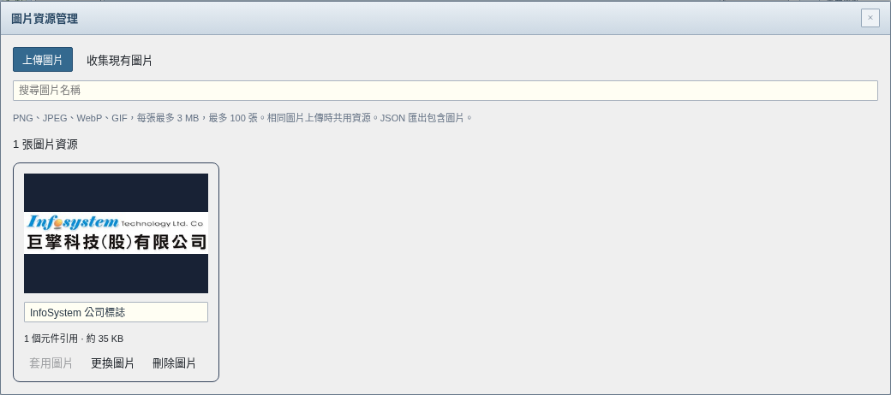

### 10.1 放入圖片

1. 先在畫布加入「圖片」元件並選取。
2. 開圖片資源管理，按「上傳圖片」。
3. 選 PNG、JPEG、WebP 或 GIF，單張最多 3 MB。
4. 在資源卡按「套用圖片」。
5. 回到屬性調整尺寸及顯示方式。

| 顯示方式       | 效果                             |
| -------------- | -------------------------------- |
| 等比例完整顯示 | 完整保留圖片，可能出現留白。     |
| 等比例填滿裁切 | 填滿元件，超出的邊緣會被裁切。   |
| 拉伸填滿       | 填滿元件，比例可能改變。         |
| 原始尺寸裁切   | 依原始尺寸放置，範圍外部分裁切。 |

### 10.2 共用與更換

- 同一圖片可由多個元件共用，卡片會顯示引用數。
- 「更換圖片」會更新所有引用該資源的元件。
- 被引用的圖片不能直接刪除；先移除或更換元件的圖片。
- 「收集現有圖片」可把舊專案元件內的圖片集中成共用資源。
- 每專案最多 100 張資源。匯出 JSON 時圖片一起保存，不需再附原始圖檔。

## 11　版本還原與備份

### 11.1 還原前先預覽

1. 停止執行。
2. 選「檔案 → 版本紀錄與還原」。
3. 點左側版本，查看右側專案資訊及畫面預覽。
4. 確定要回到該版時，按「還原此版本」，閱讀確認視窗後再確定。

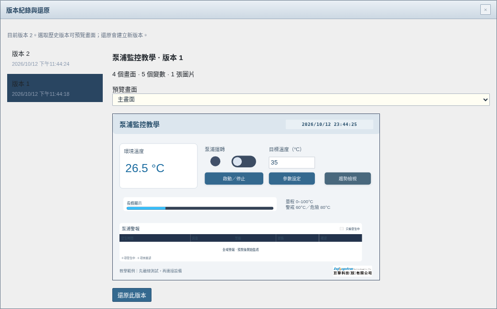

還原會取代目前編輯內容，並建立一個新版本；不會刪除舊版本。未儲存的內容可能被取代，重要修改可先匯出 JSON 或另存新專案。

警報歷史是獨立保存的事件快照，還原設計版本不會刪除既有警報歷史。

### 11.2 三種保存方式有何不同

| 方式           | 有哪些內容                                | 適合用途                   |
| -------------- | ----------------------------------------- | -------------------------- |
| 儲存專案       | 目前設計及新的保存版本，存於後端 SQLite。 | 日常工作保存。             |
| 匯出 JSON      | 目前設計、圖片、設備映射與警報設定。      | 分享設計、移到另一套系統。 |
| 完整資料庫備份 | 所有專案、版本與警報歷史。                | 系統移機、完整資料保護。   |

完整備份由管理者處理：關閉服務後備份資料庫，或使用 SQLite 的正式備份方式。運行中不要只複製 .db 而忽略 WAL 資料。

### 11.3 儲存衝突怎麼辦

如果另一個分頁或使用者已保存更新版本，系統會阻止舊版本直接覆蓋。

1. 保留目前視窗，不要反覆重新整理。
2. 先匯出 JSON，或另存新專案保留自己的修改。
3. 重新開啟原專案，比較最新內容後再整合。
4. 自動儲存出錯時會暫停，可從底部狀態列重試；重試不會略過版本檢查。

## 12　常見問題與排除方式

| 現象                         | 先檢查／處理                                                         |
| ---------------------------- | -------------------------------------------------------------------- |
| 找不到之前做的專案           | 用「開啟專案」載入；只有匯入但未儲存的內容不會加入清單。             |
| 名稱旁一直顯示修改           | 按儲存，或確認自動儲存已完成。                                       |
| 按執行卻出現專案檢查         | 依提示修正變數綁定、畫面目標、尺寸或設定。                           |
| 按鈕沒有動作                 | 確認已在預覽／執行；查看動作、綁定、啟用條件，以及設備標籤是否可寫。 |
| 燈號不跟著改變               | 確認指示燈與按鈕綁定同一布林變數。                                   |
| 改值後重新執行又回原值       | 執行值與初始值不同；停止後改變數定義的初始值，再保存。               |
| 輸入被退回原值               | 檢查空白、最小／最大值、步距；連設備時也查倍率及資料型別範圍。       |
| 趨勢一開始空白               | 等幾次取樣；確認有數值綁定、量程正確及設備資料有效。                 |
| 共通母片不能在子畫面修改     | 前往母片／圖層來源編輯。                                             |
| 畫面／變數／圖片無法刪除     | 先解除元件、母片、導航、警報或資源引用。                             |
| 關閉 Popup 數值沒有恢復      | 輸入確認時已寫入，關閉不會撤銷。                                     |
| Word=4 沒有 Bit 2 警報       | 查看 Bit 2 規則是否啟用、Word 綁定是否正確、遮罩 Bit 2 是否為 1。    |
| 按確認仍有警報               | 確認只表示已閱讀；條件恢復後才解除。                                 |
| 歷史查不到紀錄               | 確認曾保存專案、同步成功；清除搜尋／時間／等級篩選再查。             |
| 設備已填 IP 卻沒有值         | 確認啟用設備、至少一個標籤映射、選設備連線並執行，以及後端網路可達。 |
| TCP 顯示通訊例外／逾時       | 查 IP、Port、Unit ID、資料區與位址；確認設備是否啟用 Modbus。        |
| COM／RTU 無法開啟            | 查後端埠名、占用程式、Linux 權限與實體轉接器。                       |
| RTU 有連線但值不對           | 核對站號、鮑率、同位元、停止位元、位址及 Word 順序。                 |
| 使用者能開網頁，設備卻不能連 | 網頁路徑與設備通訊路徑不同，後端須能存取設備。                       |
| 窄螢幕看不到屬性             | 改用較寬桌面視窗；窄螢幕設計會隱藏右側面板。                         |

需要協助時，記下專案名稱、當時操作、錯誤文字及設備參數，並附匯出的 JSON；不要只提供「不能用」的描述。

## 附錄 A　常用快捷鍵

快捷鍵在畫布／非輸入欄位聚焦時使用。輸入框內的 Ctrl+C 等由瀏覽器處理；要保存可先離開輸入框再按快捷鍵，或直接按儲存按鈕。

| 快捷鍵                          | 功能                                                             |
| ------------------------------- | ---------------------------------------------------------------- |
| Ctrl／⌘ S                       | 儲存。                                                           |
| Ctrl／⌘ Z                       | 復原。                                                           |
| Ctrl／⌘ Shift Z，或 Ctrl／⌘ Y   | 重做。                                                           |
| Ctrl／⌘ C、V、X                 | 複製、貼上、剪下。                                               |
| Ctrl／⌘ A                       | 全選目前畫面的元件。                                             |
| Delete／Backspace               | 刪除選取的可編輯元件。                                           |
| 方向鍵                          | 選取元件微調 1 px。                                              |
| Shift＋方向鍵                   | 微調 10 px。                                                     |
| Shift＋點選                     | 多選元件。                                                       |
| Esc                             | 依目前情境關閉對話框、選單、最上層 Popup，或停止執行／清除選取。 |
| 元件分類頁籤的左右鍵、Home／End | 切換上方元件分類。                                               |

## 附錄 B　18 種元件速查

| 分類 | 元件         | 使用重點                                               |
| ---- | ------------ | ------------------------------------------------------ |
| 繪圖 | 直線         | 線寬、線型及顏色。                                     |
| 繪圖 | 矩形         | 底圖、區塊，支援邊框與圓角。                           |
| 繪圖 | 圓形         | 圓形／橢圓圖案，支援填色與邊框。                       |
| 靜態 | 文字         | 標題／說明，可綁變數；可設定字型、對齊與換行。         |
| 靜態 | 圖片         | 公司標誌、設備圖與背景圖。                             |
| 靜態 | 刻度         | 依量程與主／次刻度設定線性標尺。                       |
| 靜態 | 表格         | 設定列數、欄數及對角線的靜態框架；不是試算表資料輸入。 |
| 按鈕 | 按鈕         | 切換、設值、增減、點動與畫面／Popup 動作。             |
| 按鈕 | 開關         | 切換布林狀態。                                         |
| 顯示 | 指示燈       | 以亮／暗表示布林狀態。                                 |
| 顯示 | 數值顯示     | 小數、整數、百分比、科學記號、單位及千分位。           |
| 顯示 | 儀表         | 半圓指針、量程及警戒／危險門檻。                       |
| 顯示 | 長條顯示     | 水平／垂直長條，支援量程及門檻顏色。                   |
| 顯示 | 趨勢圖       | 依取樣間隔記錄本次執行曲線。                           |
| 顯示 | 警報清單     | 可使用元件規則、全域警報或全部警報。                   |
| 顯示 | 時間／日期   | 裝置時鐘，支援常用日期／時間格式。                     |
| 顯示 | 多狀態指示燈 | 依數值設定不同狀態的文字、顏色與外觀。                 |
| 編輯 | 數值輸入     | 最小／最大值、步距與輸入確認。                         |

百分比格式會將值乘以 100 顯示，0.125 顯示 12.5%。儀表／長條超出量程時圖形停在端點，原數值仍可顯示；門檻及量程須合理，最大值要大於最小值。

## 附錄 C　功能範圍與管理者資訊

目前提供單人編輯、一般畫面／Popup／母片、18 種元件、內部與系統變數、Modbus TCP／RTU、全域／元件警報、SQLite 保存及版本還原。

目前沒有登入／等級密碼管理、多國語言管理、硬體 OS／專案下載、遠端現場代理、伺服器持續警報／趨勢採集。關閉網頁不會持續進行使用者畫面的警報判斷；趨勢只保留本次執行資料，不是長期歷史資料庫。

| 管理事項             | 參考資訊                                                                             |
| -------------------- | ------------------------------------------------------------------------------------ |
| Windows／Ubuntu 部署 | 已發布程式需要 .NET 10 ASP.NET Core Runtime；建置才需要 Node.js 24 與 .NET 10 SDK。  |
| 執行網址             | 一般使用者使用管理者提供的 URL；服務監聽與防火牆由管理者設定。                       |
| 資料庫位置           | 開發儲存庫預設 .data/viewx.db；發布版預設執行目錄的 .data/viewx.db，可由管理者指定。 |
| Linux 串列埠         | 確認服務帳號可開啟實際串列埠，例如 dialout 群組權限。                                |
| 完整備份             | 使用 SQLite 正式備份，或停止服務後備份；含版本及警報歷史。                           |
| 文件用途             | 本手冊教操作；詳細資料欄位、API 與部署指令請看下列技術文件。                         |

延伸文件：[專案與部署說明](../README.md)、[Modbus 設備通訊規格](Modbus-設備通訊規格.md)、[SQLite 資料儲存規格](SQLite-資料儲存規格.md)。

**操作前的簡單確認：**開對專案、確認資料來源、看懂變數綁定、先保存、先離線測試，再開始設備連線。
